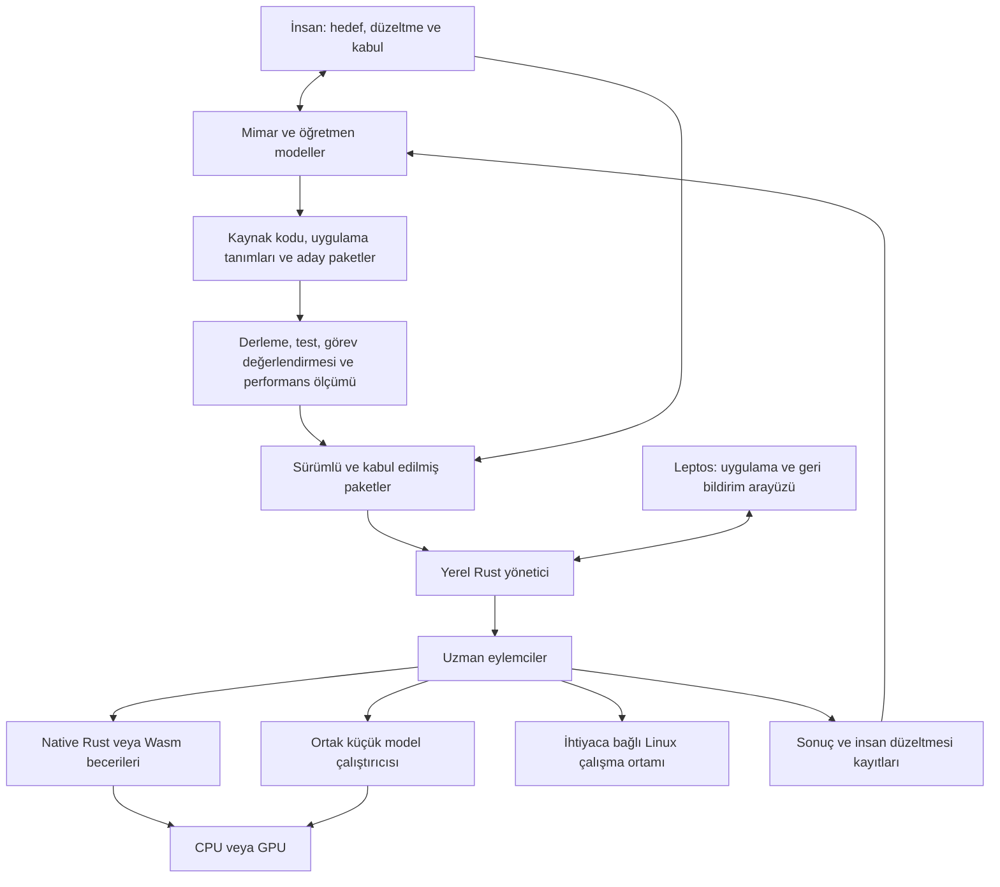

# Eylema — Rust merkezli, yerel eylemci odaklı framework — mimari taslak v0.1

Bu belge Eylema'nın tarihsel taslağıdır. Kullanıcının kendi Rust bileşenlerini geliştirme kararıyla Leptos/SQLx ve diğer hazır motor seçimleri geçersiz kalmıştır. Sonraki tasarım: [v0.2](architecture-v0.2.tr.md). Ürün adı 11 Ekim 2026 tarihinde Eylema olarak kabul edilmiştir; bu adlandırma güncellemesi eski mimari seçimleri yeniden geçerli kılmaz.

Tarih: 11 Ekim 2026. Durum: araştırma ve tasarım; çalışan framework veya ölçülmüş performans sonucu değildir. Örnek API adları öneridir, derlenmemiştir.

## Amaç ve kabul edilen yön

İnsanların ve farklı yapay zekâların geliştirebildiği; web uygulamalarını, yerel uzman eylemcileri ve GPU kullanan etkileşimli uygulamaları ortak sözleşmeler altında birleştiren, Rust öncelikli bir altyapı.

- İlk web arayüzü Leptos olacak.
- Rust/Wasm/WebGPU hesaplama çekirdeği Leptos’tan bağımsız kalacak.
- Yüksek seviyeli tanımlar kullanılacak; gerektiğinde doğrudan Rust ve GPU kodu yazılabilecek.
- Günlük işlerin ana yürütücüleri yerel eylemciler olacak.
- Büyük mimar modeller kod, beceri, örnek, test ve iyileştirme adayları üretecek. İnsanlar hedefleri, düzeltmeleri ve kabul koşullarını belirleyecek.
- Linux üzerinde native Rust çalışma biçimi bulunacak. Gerçek Linux konuk ortamları ve tarayıcı Linux laboratuvarı seçilebilir eklentiler olacak.
- Doğrudan bağımlılıklar gerekçeli ve sınırlı tutulacak. Geçişli bağımlılıkların maliyeti de izlenecek.
- Başka geliştiricilerin ekleme yapabilmesi için sözleşmeler, sürüm kuralları ve uyumluluk testleri açık olacak.

Genellik, her uygulamanın bütün alt sistemleri yüklemesi anlamına gelmeyecek. Her iş yükünde en hızlı olma iddiası yerine, farklı görevlerde tekrarlanabilir ölçümler yayımlanacak.

## CachyOS benzetmesinin mimarideki karşılığı

CachyOS, Arch tabanını CPU’ya göre derlenen paketler, seçilmiş optimizasyonlar ve ayarlanmış kernel seçenekleriyle bir ürün halinde sunuyor. Buradan aldığımız ilke; bileşen seçimi, entegrasyon, ölçüm ve kullanıcı deneyiminin beraber tasarlanmasıdır. Bu benzetme CachyOS’un zorunlu dağıtım hedefimiz olacağı anlamına gelmez. [CachyOS optimize depoları](https://wiki.cachyos.org/features/optimized_repos/)

Framework üç teslimat yüzeyi sunmalı:

- **Küçük çekirdek ve SDK:** Başka projelerde bağımsız kullanılabilen Rust sözleşmeleri ve yürütme bileşenleri.
- **Hazır uygulama profilleri:** Web/SaaS, yerel eylemci ve GPU/3D profillerinde birlikte test edilmiş modüller, geliştirme komutları ve dağıtım tarifleri.
- **Açık genişletme sistemi:** Topluluğun beceri, model, veri, arayüz ve ortam adaptörlerini ekleyebilmesi için belgelenmiş sözleşmeler ve uyumluluk testleri.

Geliştirme profili kısa geri bildirim süresini, üretim profilleri hedef cihazdaki çalışma maliyetini gözetir. Native CPU’ya özel derleme, Wasm boyutu/başlangıcı ve GPU iş planlama ayrı ölçülür. Taşınabilir temel hedef korunur; daha özel donanım paketleri destek kontrolüyle seçilir. Genel dağıtılan bir binary geliştiricinin makinesinin CPU özelliklerine sessizce bağlanmaz.

Topluluk için benimsenme ölçüsü yalnız benchmark sıralaması olmayacak: ilk çalışan uygulamaya ulaşma süresi, sürüm yükseltme maliyeti, anlaşılır hata mesajları, AI’ın ilk denemede doğru değişiklik yapma oranı ve bağımsız geliştiricinin eklenti yazabilmesi de izlenecek.

## Topoloji



Uygulama tarayıcıda çalışıyorsa yerel hesaplama Web Worker + Wasm/WebGPU yolunu kullanır. Cihazdaki dosya, süreç veya sürekli çalışan servislerle etkileşim gerekiyorsa native Rust yönetici gerekir. Tarayıcı ile bu yönetici arasındaki bağlantı eşleştirilmiş ve yetkilendirilmiş bir köprü olmalıdır; açık bir yerel yönetim portu yeterli değildir.

Başlangıçta güvenilen eylemciler tek Rust servisinde görevler olarak çalışır. Süreç izolasyonu veya Linux araçları gereken işler ayrı yürütücülere gönderilir. Eylemci başına ayrı model kopyası, servis veya sanal makine zorunlu değildir.

## Çekirdek sözleşmeler ve modüller

| Mantıksal modül | Sorumluluk | Sınır |
|---|---|---|
| Core | Kimlikler, sürümler, yetenekler, hatalar ve temel tipler | Leptos, SQLx, model motoru veya GPU cihazı içermez |
| Definition | Uygulama grafiği, şema, tipli query/command/task tanımları | Geliştirme zamanında çalışır; üretim uygulamasına derleyici taşımaz |
| Runtime | Yerel eylemciler, görev kuyruğu, bütçe, iptal, tekrar deneme ve denetim | AI sağlayıcılarından bağımsızdır |
| Compute | CPU/GPU görevleri, model yaşam döngüsü, veri taşıma ve yürütücü seçimi | UI ve HTTP bilgisi taşımaz |
| Web | Leptos sayfaları, formlar, yönlendirme, SSR/hydration ve geri bildirim ekranları | Veritabanı kimlik bilgileri veya yerel host yetkileri taşımaz |
| Server/Data | API, kimlik, yetki, veri erişimi, dosyalar, kalıcı işler ve gerçek zamanlı olaylar | Yetkiyi her sunucu eyleminde uygular |
| Learning/Evaluation | Düzeltmeler, veri seçimi, görev değerlendirmeleri ve aday paketler | Çalışan uygulamanın model eğitimi yüklemesini gerektirmez |
| Environment | Linux ortamları, süreç/dosya araçları, yaşam döngüsü ve çıktı alma | Ayrı yetkili node worker kullanır |
| Tooling | CLI, kod üretimi, etki analizi, tanılama, paketleme ve ince MCP adaptörü | İnsan ve AI aynı işlemleri kullanır |

Bunlar mantıksal sınırlardır; ilk prototipte her satır ayrı crate veya servis olmayacaktır. Özellikle veritabanı, kuyruk ve kayıt işlevlerini baştan ayrı dağıtık servislere bölmek gerekmiyor.

Uçtan uca web kapsamı; veri modelleri ve açık migration dosyaları, query/command API’leri, oturum ve yetki, doğrulanan formlar, routing, SSR, asset/dosya depolama, arka plan işleri, olay akışı, önbellek, tanılama ve dağıtım paketlerini kapsar. Bunlar seçilebilir modüllerdir. Veritabanı şemasını üretim açılışında sessizce yeniden şekillendirmeyiz.

## Az bağımlılık politikası

| İhtiyaç | Başlangıç tercihi | Yüklenme koşulu |
|---|---|---|
| Arayüz | Leptos | Web hedefi |
| Sunucu ve native eşzamanlılık | Axum + Tokio | Sunucu/native hedef |
| Sözleşme taşıma | Serde + JSON araçları | İlgili sınır/araç |
| GPU | wgpu | GPU özelliği |
| Kalıcılık | SQLx; başlangıçta yerel SQLite, sunucu için PostgreSQL sürücüsü | Hedefe göre seçilen sürücü |
| Yapılandırılmış tanılama | tracing | Native çalışma ve araçlar |
| Küçük model çalıştırma/eğitme | İlk ölçülecek aday Burn | AI modülü; kesin seçim prototipten sonra |

Bu tablo tüm geçişli bağımlılıkları listeleyen bir Cargo manifesti değildir. Wasm köprüleri, TLS, kimlik doğrulama ve gerekli ağ istemcisi gibi destek bağımlılıkları somut özellik seçildiğinde ayrıca kayda alınır. Rust önceliği; SQLite, Linux veya donanım sürücülerinin de tamamen Rust olduğunu iddia etmez.

Tokio’nun sınırlı mesaj kanalları görevler arasında yük kontrolü için temel sağlar; ayrıca bir actor framework’ünü ilk sürümün zorunlu bağımlılığı yapmak gerekmiyor. [Tokio kanal sözleşmesi](https://docs.rs/tokio/latest/tokio/sync/mpsc/)

Burn, Rust model tanımı, eğitim ve inference ile Wasm CPU/WebGPU yollarını bir araya getiren bir adaydır. ONNX operatör desteği sınırlıdır; ilk gerçek modelin çalışması doğrulanmadan seçimi kilitlenmez. Burn, Candle ve ONNX Runtime’ı aynı anda varsayılan pakete eklemeyiz. Model uyumluluğu veya performans gerektirirse adaptör tercihini değiştiririz. [Burn resmî deposu](https://github.com/tracel-ai/burn)

Her yeni bağımlılığın kaydı şu soruları cevaplar: hangi gereksinimi karşılıyor, hangi özellikleri açılıyor, derleme/ikili boyut etkisi nedir, kim bakıyor, sürümü nasıl kilitleniyor, hangi sözleşmenin arkasında ve değiştirme maliyeti nedir? Kilit dosyası tutulur; kaynak ve bağımlılık envanteri yayımlanır. Kaynak erişimi, tüm dış bileşenleri zaten kontrol ettiğimiz anlamına gelmez.

Kriptografi, veritabanı, TLS, hypervisor veya genel tensor motorunu bağımlılık sayısını azaltmak için yeniden yazmak başlangıç kapsamına alınmaz.

## Yüksek seviyeli tanım yaklaşımı

İlk dil Rust olacak. Ayrı bir programlama dili ve özel parser geliştirmek yerine, tipli Rust builder’ları kullanan küçük bir tanım programı sürümlü JSON uygulama grafiği üretecek. CLI bu grafikten bağlantı kodlarını, şemaları ve dokümantasyonu oluşturacak.

Örnek, tasarlanmakta olan API’yi gösterir; mevcut bir kütüphaneye ait çalışan kod değildir:

```rust
App::new("document-workbench")
    .query(DOCUMENT_LIST)
    .command(SAVE_REVIEW)
    .page(Page::new("documents", "/documents")
        .load(DOCUMENT_LIST)
        .view("document_table"))
    .actor(Actor::new("document.classifier")
        .on(DOCUMENT_ADDED)
        .placement(Placement::LocalRequired)
        .skills([EXTRACT_FEATURES, CLASSIFY, WRITE_DRAFT])
        .model(ModelRef::locked("document-student"))
        .policy("draft_only")
        .escalation("teacher_review")
        .learning(Learning::CandidatePackages))
    .environment(Environment::linux("code-lab")
        .backend(Backend::MicroVm)
        .image(ImageRef::locked("rust-toolchain")))
    .finish()
```

`DOCUMENT_LIST` gibi anahtarlar girdi ve çıktı tiplerini taşır. Sunucu handler’ı, istemci çağrısı ve uygulama tanımı aynı sözleşmeye bağlanır. Derleyici tip uyuşmazlıklarını; ayrıca framework kontrolü eksik veya çift kayıtları bulur. Bütün doğruluk koşullarının derleme zamanında çözüleceği iddia edilmez.

Tanım programı yalnız contracts ve definition SDK’ya bağımlıdır; üretilmiş UI/server koduna bağımlı olmaz. Böylece kod üretim döngüsü kurulmaz. Üretilen dosyalar ayrı dizinde; el yazısı Rust, Leptos bileşenleri, GPU kodları ve migration’lar kendi dizinlerinde tutulur. Kaynak konumu bilgisi hata mesajını ilgili tanım düğümüne bağlar.

Şema sürümü, wire protokolü, veritabanı migration’ı ve model sürümü ayrı izlenir. JSON Schema, veritabanı indeksi veya işlem davranışının yerine geçmez. Tekrar üretilebilir çıktı ayrıca kontrol edilir; tanımın Rust programı olması kendiliğinden saf/deterministik olmasını sağlamaz.

## Yerel eylemciler ve öğrenme

Bir eylemci; görev sözleşmesi, durum, yetkili beceriler, kaynak bütçesi ve sonuç kaydından oluşur. Her eylemcinin LLM olması gerekmez. Derlenmiş bir Rust işlemi, kural sistemi, küçük sınıflandırıcı veya bunları birleştiren iş akışı olabilir.

Çalışma döngüsü:

`olay → kural/bilgi erişimi → gerekirse küçük model → yetkili beceri → sonuç kaydı`

Öğrenme döngüsü:

`başarısızlık veya insan düzeltmesi → öğretmen çalışması → doğrulanmış örnek → aday paket → bağımsız değerlendirme → kabul → dağıtım`

Üç farklı güncelleme türü bulunur:

1. **Bilgi:** Belgeler, örnekler veya yerel arama içeriği güncellenir.
2. **Beceri/politika:** Kod, araç sırası, eşik veya iş akışı değişir.
3. **Model:** Ağırlıklar veya adaptörler eğitimle değişir.

İlk ikisi model eğitimi gerektirmez. Büyük modelin yanıtı otomatik doğru etiket sayılmaz. Örnekler çalıştırılabilir doğrulayıcılar ve insan düzeltmeleriyle seçilir. Öğretmenin görmediği değerlendirme görevleri tutulur. Küçük modelin öğretmenin bütün genel yeteneklerini devraldığı varsayılmaz.

Paket; beceri kodu, model referansı, sözleşme sürümleri, donanım gereksinimleri ve değerlendirme raporunu beraber taşır. Yeni sürüm önce gölge veya sınırlı kullanımda değerlendirilir. Geri dönüş; kod/model geri almanın yanında değişmiş kalıcı verinin uyumluluğunu da dikkate alır.

İnsan gözetimi her düşük maliyetli eylemi tek tek onaylamak zorunda değildir. İnsan tanımlı çalışma sınırlarını, öğretim örneklerini ve sürüm kabulünü yönetir; belirsiz veya kapsam dışı işler inceleme kuyruğuna gider. İnternet veya öğretmen modeli yokken yerel yetenekler çalışır; çözülmeyen işin davranışı görev sözleşmesinde bellidir.

Microsoft Agent Lightning’in güncel yapısı eğitim ile gerçek ajan yürütmesini ayrı bileşenler halinde ele alıyor. Bizim için yöntem ve adaptör referansıdır; Rust uygulamasının zorunlu üretim bağımlılığı değildir. [Agent Lightning](https://github.com/microsoft/agent-lightning)

## Linux ve çalışma ortamları

| Seçenek | Gerçekte çalıştırdığı yapı | Rolü |
|---|---|---|
| Native Linux | Mevcut Linux üzerinde Rust yönetici ve servisler | Yerel eylemcilerin ana çalışma yolu |
| Linux microVM | Ayrı konuk kernel + rootfs + Rust guest agent | Kod geliştirme, test ve izole araç ortamı |
| Tarayıcı Linux | Wasm tabanlı CPU/donanım emülasyonu içinde Linux | İsteğe bağlı laboratuvar ve uyumluluk ortamı |
| Yönetilen uygulama ortamı | Seçilen native/VM altyapısında uzun ömürlü servisler | Sağlık, yeniden başlatma, kalıcı disk ve sürüm yönetimi |

Linux’un kendisi tamamen Rust yazılmış değildir. Resmî çekirdekte Rust desteği vardır; kernel Rust’ı `no_std` bağlamındadır. Rust kullanıcı alanı servisleri çalıştırmak için özel Rust kernel modülü gerekmez. Kendi kernel fork’umuz ilk teslimatın önkoşulu olmaz. [Linux programlama dilleri](https://www.kernel.org/doc/html/latest/process/programming-language.html), [Kernel Rust sınırları](https://docs.kernel.org/rust/general-information.html)

Rust ile yazılmış Firecracker, Linux KVM üzerinde microVM çalıştırma adayıdır. Konuk kernel/rootfs ayrı sürümlenen imajlardır; her web ziyaretçisine indirilmez. macOS üzerinde doğrudan Linux KVM mevcut değildir; Firecracker hedefi uygun Linux host veya KVM sunabilen doğrulanmış ortamdır. [Firecracker](https://github.com/firecracker-microvm/firecracker)

Browser Linux için v86 ve JSLinux benzer işlerdir. v86’nın mevcut kısıtları arasında 64-bit ve çok çekirdek eksikleri bulunur; güncel JSLinux x86_64 ve RISC-V seçenekleri sunar. Bunların imajları ve performansı native Linux ile aynı kabul edilmez. [v86](https://github.com/copy/v86), [JSLinux teknik notları](https://bellard.org/jslinux/tech.html)

WebVM’in Linux araçlarını syscall uyumluluğuyla çalıştırması, gerçek Linux kernel boot etmekten farklı bir seçenektir. LKL ise kernel kodunu uygulamaya linkleyebilir; ayrı kernel izolasyonuna sahip microVM’in yerine otomatik geçmez. [CheerpX mimarisi](https://cheerpx.io/docs/overview), [LKL](https://github.com/lkl/linux)

Ortam API’si create/start/status/exec/files/stop/destroy işlemlerini kapsar. Snapshot, pause ve GPU erişimi ayrı yeteneklerdir; her adaptör bunları sağlamaz. İstenen yetenek yoksa açıklayıcı hata üretilir. Bellek snapshot’ı, disk snapshot’ı ve ağ bağlantılarının devamlılığı aynı garanti değildir.

Native GPU işleri ayrı hesaplama yürütücüsünde kalabilir. Firecracker seçimi veya tarayıcıda Linux boot edilmesi doğrudan GPU passthrough, CUDA veya konuk WebGPU erişimi garantilemez. Kernel yönetim API’sini doğrudan modele açmak yerine yetkili ortam worker’ı işlemleri uygular.

## Performans ve yürütme kuralları

- Sık ve küçük işler native Rust/Wasm CPU yoluyla başlar. Tensor/batch işleri için GPU seçimi ölçümle yapılır. Küçük modellerde CPU’nun uygun olabileceği ONNX’in performans rehberinde de belirtiliyor. [ONNX performans rehberi](https://onnxruntime.ai/docs/tutorials/web/performance-diagnosis.html)
- Aynı model sürümünü mümkün olduğunca ortak çalıştırıcı yükler. GPU verisinin gereksiz yükleme/geri okuma maliyeti ölçülür. Farklı runtime/device sınırlarında otomatik sıfır kopya garantisi verilmez.
- UI, I/O ve yoğun hesaplama birbirini engellemeyecek yürütme düzenine ayrılır. Ayrı worker’lar aynı fiziksel GPU’da kaynak rekabetini ortadan kaldırmaz.
- Kuyruklar sınırlıdır; dolduğunda bekletme, reddetme veya birleştirme davranışı görev türüne göre tanımlanır.
- Kalıcı işlerde tekrar teslim mümkündür. Dış etkiye sahip işlemler idempotency anahtarı ve sonuç kaydı kullanır; evrensel exactly-once garantisi verilmez.
- Modelin düşük güveni tek başına güvenilir hata göstergesi sayılmaz. Devretme koşulları ölçülmüş hata, kapsam, doğrulayıcılar ve görev kurallarıyla belirlenir.
- GPU’ya gönderilmiş işin anında kesilebileceği varsayılmaz. İptal; yeni parçaların gönderilmesini durdurabilir ve geç sonucu yok sayabilir; kaynaklar tamamlanma bilgisine göre serbest bırakılır.
- LocalRequired işleri sessizce buluta taşınmaz. Model dosyası indirmek ile kullanıcı girdisini uzaktan işlemek ayrı politikalardır.
- Tarayıcı için adapter/bellek/operatör yetenekleri kontrol edilir; ayrıca küçük gerçek görev denenir. Destek açıklaması, fiziksel cihaz testi yerine geçmez.

Raporlanacak ölçüler: görev başarısı, yanlış eylem oranı, p50/p95/p99 uçtan uca gecikme, throughput, soğuk/sıcak başlangıç, RAM/VRAM, indirme ve veri aktarım boyutu, mümkünse enerji, öğretmene başvuru oranı, derleme süresi ve düzeltme başına insan/AI geliştirme maliyeti.

## Mimar AI’ların geliştirme kontrolü

CLI’nin insan okunur çıktısı ve sürümlü JSON çıktısı aynı işlemleri sunar: uygulama grafiği, bağımlılık grafiği, yetenekler, etki analizi, derleme, test, değerlendirme, performans raporu, paketleme ve geri dönüş bilgisi. MCP bunlara eklenen ince bir erişim yolu olabilir.

AI’ın değiştirdiği kod, üretilen kod ve runtime tarafından yapılan işlemler izlenebilir olur. Makro ve kod üretimi gerektiğinde normal Rust kaynaklarına kadar incelenebilir. Her şeyi gizli bir orkestrasyon katmanına bağlamayız. Farklı model sağlayıcıları araç/şema desteği bakımından adaptör testlerinden geçer; ortak protokol kullanmaları davranışlarının aynı olduğu anlamına gelmez.

Üretimde kabul edilmiş görevleri yürütme ile geliştirmede kaynak kodu değiştirme ayrı yetkilerdir. Bu ayrım mimar AI’ın kodu geliştirme yeteneğini azaltmaz; hangi değişikliğin hangi uygulama sürümüne dönüştüğünü görünür kılar.

## Topluluğun üzerine geliştireceği sözleşme

İlk açık yüzeyler ActorSpec, SkillPackage, ComputeTask, ModelPackage, EnvironmentSpec ve EvaluationReport olur. Bunların tipleri, hata anlamları, sürüm geçişleri ve yetenek keşfi belgelenir. Her eklenti örnek veri ve uyumluluk testleriyle birlikte gelir.

Rust crate uzantıları ilk aşamada normal derleme/linkleme yolunu kullanır. Farklı Rust derleyici sürümleri arasında dinamik kütüphanelerin sabit ABI sunduğu varsayılmaz. Sonraki dinamik eklentiler için süreç protokolü veya Wasm bileşen sözleşmesi ayrıca değerlendirilebilir. Başka dillerin katılımı açık protokoller üzerinden mümkündür; ilk SDK’nın Rust olması bütün diller için SDK teslim edildiği anlamına gelmez.

Yayımlanacak temel malzemeler: kısa mimari sözleşme, karar kayıtları, RFC/değişiklik süreci, sürüm ve kullanımdan kaldırma politikası, katkı rehberi, minimal uzantı örnekleri, tekrarlanabilir benchmark araçları ve hedef destek matrisi. Lisans ve katkı koşulları kamuya açılmadan önce açıkça kararlaştırılır.

## Geliştirme sırası ve kabul kapıları

| Aşama | Çıktı | Kabul kanıtı |
|---|---|---|
| 0 — Risk prototipleri | Aynı küçük CPU/GPU görevi; bir küçük model; Linux Rust node; microVM ve browser Linux fizibilitesi | Hedef cihazlarda gerçek çıktı, bellek ve soğuk/sıcak süre ölçümleri; desteklenmeyen yetenekler açık |
| 1 — Ortak sözleşme | Tipli uygulama tanımı, JSON grafik, CLI ve minimal query/command/page | Aynı girdide tekrarlanabilir üretim; hatalı tip ve eksik handler için anlaşılır hata |
| 2 — Yerel eylemci döngüsü | Tek uzman eylemci, ortak model, kalıcı işler, Leptos geri bildirim ekranı | Bağlantı kesilince tanımlı iş sürer; hata/yeniden başlatma ve tekrar teslim senaryosu doğrulanır |
| 3 — Öğretim ve sürüm | Öğretmen + insan düzeltmesi + aday beceri/model + değerlendirme | Ayrı test görevlerinde karşılaştırma; kabul edilmiş pakete geçiş ve geri dönüş |
| 4 — Full-stack modüller ve ortamlar | Kimlik/yetki, veri/form/dosya, kalıcı iş/olay, Linux sandbox ve yönetilen servis | Uçtan uca uygulama akışı, direkt API yetki kontrolü, ortam aç-test et-çıktı al-kapat akışı |
| 5 — Genellik ve topluluk | Web/SaaS örneği, yerel AI örneği, GPU/3D örneği; uzantı SDK’sı | Üç örnek aynı çekirdeği kullanır; bağımsız bir eklenti uyumluluk paketini geçer; ölçümler yeniden üretilebilir |

İlk uçtan uca örnek önerisi: yerel belgeleri sınıflandıran, taslak üreten, insan düzeltmesini kaydeden ve kabul edilmiş yeni beceri/model paketini kullanan bir çalışma alanı. Bu, mimariyi somutlaştıran referans uygulamadır; framework’ün alanını belge işlemeyle sınırlamaz.

Takvim, hedef cihaz ve ilk model ölçümlerinden sonra çıkarılmalıdır. Bu belgede VM başlatıldığı, model eğitildiği, kod derlendiği veya bir performans hedefinin karşılandığı iddia edilmiyor.
