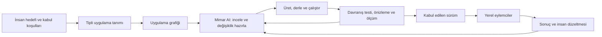

# Eylema — AI ile geliştirilen ve AI çalıştıran Rust web platformu — v0.2

> Eylema'nın güncel ürün yönü ve geliştirme sırası [v0.3 taslağındadır](../docs/architecture.md). Bu sürüm önceki mimari kararların kaydıdır. Ürün adı 11 Ekim 2026 tarihinde Eylema olarak kabul edilmiştir; bu adlandırma güncellemesi tarihsel taslağın mimari kapsamını değiştirmez.

Tarih: 11 Ekim 2026. Durum: mimari karar ve geliştirme taslağı. Henüz uygulama kodu, eğitim veya performans sonucu değildir. Bu belge v0.1’in Leptos/SQLx ve diğer hazır motor seçimlerinin yerini alır.

## Ürün amacı

İnsanların ve büyük mimar yapay zekâların uygulamaları tanımlayabildiği, geliştirebildiği, çalıştırabildiği ve sonuçlarını doğrulayabildiği bir web uygulama platformu. Uygulamaların içinde uzman yerel eylemciler çalışır; insanlar ve öğretmen modeller bu eylemcilerin becerilerini, bilgisini ve gerektiğinde küçük modellerini geliştirir.

Rust; bize ait uygulama motorlarının, araçların ve yerel yürütmenin ortak geliştirme dilidir. İhtiyaç ortaya çıktıkça kendi bileşenlerimizi geliştiririz. Önceki çalışmaların algoritmalarından, açık standartlarından, araştırmalarından ve test yöntemlerinden yararlanırız. Kaynak kodu yeniden kullanımı varsa kökenini ve koşullarını ayrıca kaydederiz.

Başarı ölçütü, AI’ın platform üzerinde doğru değişiklik yapabilmesi ve bunun gerçek uygulama davranışıyla doğrulanmasıdır. Çalışma performansı, geliştirme süresi, bakım maliyeti ve topluluk katkısı beraber değerlendirilir.

Platformun hedefi herkese açık yayımlanmak ve kullanıcıların kendi AI araçlarıyla GitHub üzerinden katkı verebilmesidir. AI ile geliştirme, uygulama içi AI ve topluluk katkıları aynı belgelenmiş sözleşmelerden yararlanır. Bu belge yayımlanmış bir GitHub deposu veya tamamlanmış public ürün olduğunu ifade etmez.

Güncel takım kararı: büyük dış modeller geliştirme ekibini, donanıma göre seçilen yerel modeller işletim ekibini oluşturur. İhtiyaçtan GitHub PR’a gidiş ile yerel model takımının ölçüm, atama ve güncelleme akışları ayrı sürümlü protokollerdir. Ayrıntılar [AI takım protokolleri v0.1](../docs/development-and-operations.md) belgesindedir.

## Bağlayıcı mimari kararlar

- UI, sunucu uygulama katmanı, veri erişimi, eylemci yürütmesi ve geliştirme araçları kendi Rust bileşenlerimiz olacak.
- Leptos, SQLx, Axum, Tokio, Serde, wgpu ve hazır model motorları varsayılan üretim bağımlılığı olarak seçilmiş değildir. Bunları kendi API’mizin arkasında gizleyerek kullanmayız.
- İlk kendi bileşenlerimizin varsayılan hedefi sıfır üçüncü taraf Cargo paketidir; Rust araç zincirinin sağladığı `std`, `core` ve `alloc` bu sınırın içindedir. Bu, henüz doğrulanmış bir bağımlılık envanteri değildir.
- Rust araç zinciri, işletim sistemi, tarayıcı, sürücüler, model ağırlıkları ve dış servisler ayrı bağımlılık sınıfları olarak görünür kalır. Kendi Rust kodumuzun bulunması bunları ortadan kaldırmaz.
- Bütün genel amaçlı motorları baştan tamamlamayız. Çalışan uygulamanın gerektirdiği küçük özellik dilimleriyle ilerleriz; desteklenmeyen yetenekler açıkça bildirilir.
- Uygulama grafiği ve araç sözleşmeleri AI sağlayıcısından bağımsız olur. Yerel görevlerin devamı sürekli bulut LLM erişimine bağlanmaz.
- Linux native hedefi ana yerel yürütme yoludur. Seçilebilir Linux konuk ortamı ve tarayıcı Linux laboratuvarı tasarımda korunur; aynı yetenekleri sundukları varsayılmaz.

## Linux ve saf Rust sınırı

Uygulanabilir hedef: Linux üzerinde çalışan, kendi Rust servisleriyle yönetilen ve Rust ile uygulama geliştiren platform.

Mevcut Linux çekirdeğinin C bölümleri C derleyicisiyle, etkinleştirilen Rust bölümleri `rustc` ile derlenir. Çekirdeği yalnız `rustc` kullanarak derlemek veya bütün Linux’u Rust’a çevirmek bu framework kapsamından ayrı bir işletim sistemi çalışması olur. Kernel yapılandırması ve imaj üretimini kendi Rust araçlarımızla yönetebiliriz; bunun kaynak dilini değiştirmediğini açıkça belirtiriz. [Linux programlama dilleri](https://docs.kernel.org/process/programming-language.html), [Rust destekli kernel derleme](https://docs.kernel.org/rust/quick-start.html)

Browser hedefinde üretilen HTML, CSS, Wasm ve gerektiğinde küçük JavaScript bağlantı kodu bulunur. Köprü bizim kontrolümüzde olabilir; tarayıcının kendisi yine platform bağımlılığıdır. GPU tarafında da shader çıktıları ve donanım sürücüleri benzer bir sınır oluşturur. “Saf Rust framework motoru” iddiasının kapsamı bu sınırlarla birlikte yayımlanmalıdır.

## AI geliştirme döngüsü

Bu döngü hem insan hem AI için aynı araçlarla çalışır. CLI, görsel geliştirme ekranı ve ilerideki MCP bağlantısı aynı işlem sözleşmelerine erişir. Farklı arayüzler birbirinden bağımsız ikinci kontrol sistemleri oluşturmaz.

## Platformun uygulama hakkında sunduğu bilgi

Bir AI’ın yalnız dosya aramasıyla keşfetmesine bırakılmayacak bilgiler:

| Bilgi | AI’ın cevaplayabileceği soru |
|---|---|
| Sayfa ve bileşen grafiği | Bu ekran hangi duruma, veriye ve işlemlere bağlı? |
| Tipli query/command sözleşmeleri | Bu değişiklik hangi çağrıları etkiler? |
| Veri ve migration tanımları | Saklanan verinin hangi sürümleri etkilenir? |
| Eylemci ve beceri tanımları | Bu görevi kim, hangi araçlarla ve hangi bütçeyle yapabilir? |
| Platform yetenekleri | İş tarayıcıda mı, yerel Linux’ta mı, GPU’da mı çalışabilir? |
| Test ve değerlendirme bağları | Bu davranışı hangi senaryo doğruluyor? |
| Sürüm ve köken kayıtları | Çalışan sonuç hangi kod, model ve beceri sürümüne ait? |

Bu grafik sistemin bütün davranışını matematiksel olarak bildiğimiz anlamına gelmez. Keyfî Rust kodu için sözleşmenin dışında kalan davranışlar ayrıca test ve ölçüm gerektirir.

İlk tanım düğümleri `Entity`, `Query`, `Command`, `Page`, `Actor` ve `Resource` olabilir. Compute, model ve ortam tanımları ihtiyaç doğdukça genişletilir. Normal Rust builder’ları kullanılır; başlangıçta Rust kaynak kodunu çözümleyen ayrı bir dil derleyicisi yazılmaz.

Tanım kaynağı tek olur; uygulama grafiği ondan üretilir. Kaynakla bağımsız düzenlenen ikinci bir grafik kopyası tutulmaz. Kalıcı düğüm kimlikleri, dosya yolundan bağımsızdır. Üretilen dosyalar el yazısı genişletme kodlarından ayrılır.

## Kendi bileşenlerimiz

| Bileşen | İlk sorumluluk | İleride genişleme |
|---|---|---|
| Core | Tipli kimlik, hata, sürüm ve yetenek sözleşmeleri | Uyumluluk ve eklenti sözleşmeleri |
| Definition/Tooling | Rust tanım programı, grafik çıktısı, kontrol ve CLI | Etki analizi, önerilen değişiklik planları, kod üretimi |
| UI | HTML üretimi, kararlı eleman kimlikleri, olay bağlama, küçük durum güncellemeleri | Reaktivite, yönlendirme, erişilebilir bileşenler, seçici yükleme |
| Server | Yerel geliştirme isteklerini tipli işlemlere bağlama | Üretim protokolü, oturum, yetki ve akış desteği |
| Data | Tipli kayıt, sürüm ve açık kalıcılık sözleşmesi | Sorgular, indeksler, migration, gerektiğinde kendi protokol adaptörleri |
| Actors | Sınırlı kuyruk, durum, görev kimliği, beceri çağrısı ve sonuç kaydı | Kalıcı görevler, süreç yürütücüleri ve node koordinasyonu |
| Compute/AI | CPU referans işlemleri ve tek dar modelin çıkarımı | Gereken tensor işlemleri, eğitim, GPU ve model biçimleri |
| Environment | Linux üzerinde süreç, dosya ve uygulama yaşam döngüsü | Konuk Linux, snapshot ve browser laboratuvarı |
| Evaluation | Görev senaryosu, doğrulayıcı, ölçüm ve paket kabulü | Öğretmen karşılaştırmaları ve topluluk uyumluluk takımları |

Bu liste ayrı servisler kurma talimatı değildir. İlk teslimat az sayıda crate ve çalıştırılabilir programla başlayabilir. Dış bir crate’i kaldırırken onun bütün özelliklerini yeniden üretmek zorunda değiliz; kendi sözleşmemizin gerektirdiği özellikleri uygulayıp destek matrisini yayımlarız.

## Yerel eylemci ve öğrenme düzeni

Günlük yol: `olay → kural/bilgi → gerekirse küçük model → izinli beceri → sonuç`.

Öğretim yolu: `örnek veya insan düzeltmesi → öğretmen çalışması → aday beceri/model → ayrı değerlendirme → kabul edilmiş paket`.

Eylemci başına ayrı LLM, süreç veya işletim sistemi zorunlu değildir. Güvenilen eylemciler tek süreçte görevler olarak başlayabilir; bunun bellek ve çökme izolasyonu sağlamadığı açık tutulur. Model çalıştırıcısı uygun olduğunda eylemciler arasında paylaşılır.

Bilgi güncelleme, beceri/iş akışı güncelleme ve model ağırlığı eğitimi ayrı işlemlerdir. İlk iç AI, kendi Rust kodumuzla çalıştırılan küçük bir öğrenilmiş sınıflandırıcı olabilir. Büyük dil modeli motoru veya genel eğitim altyapısı henüz teslim edilmiş sayılmaz. İlk öğretmen çıktıları ve insan etiketleri dosya/paket olarak alınabilir; çevrimiçi model servis bağlantıları ayrı yetenek olarak eklenir.

`ActorPackage`; beceri, model, araç sözleşmesi, veri kökeni, donanım gereksinimi ve değerlendirme sürümlerini birlikte taşır. Öğretmenin yanıtı otomatik doğru etiket sayılmaz. Yeni sürüm ayrılmış görevlerde ölçülür; hata halinde önceki sürüme dönüş ve kalıcı veri uyumluluğu değerlendirilir.

İnsanlar hedefleri, yetki sınırlarını ve kabul koşullarını tanımlar. Bu sınırlar içindeki düşük etkili görevler her adımda insanı beklemeyebilir. Çalışan eylemcinin kod/model sürümünü değiştirmek ayrı bir geliştirme ve yayın işlemidir.

## İnsan ve AI için ortak araç yüzeyi

Önerilen işlemler: `inspect`, `capabilities`, `impact`, `check`, `build`, `run`, `test`, `evaluate`, `measure`, `package` ve `rollback-plan`. Bunlar mevcut komutlar değildir; araç sözleşmesi adaylarıdır.

Her hata insan okunur açıklamanın yanında sürümlü alanlar taşır: `code`, `phase`, `node_id`, `source`, `expected`, `actual`, `help`. Kaynak konumu gerçek doğruluk düzeyinde verilir. Çalıştırılmış, atlanmış ve başarısız kontroller farklı durumlar olarak sunulur.

Bir değişiklik planı etkilenen düğümleri, beklenen çıktıları, gerekli migration’ları ve doğrulama görevlerini gösterebilir. Öneri, uygulanmış değişiklik ve çalışan sürüm ayrı kimlikler taşır. Gerektiğinde çalışma izleri girdileri ve dış sonuçları kaydeder; dış etkileri yeniden yürütmeden bütün işlemler için tam deterministik tekrar garantisi verilmez.

## İlk uçtan uca doğrulama

Küçük bir görev/inceleme uygulaması:

1. Rust tanımı sayfayı, kayıt tipini ve işlemleri belirler.
2. Kendi UI motorumuz HTML üretir; kullanıcı girdisi kendi olay bağlantımızdan geçer.
3. Kendi sunucu katmanımız girdiyi doğrular ve tipli görevi oluşturur.
4. Yerel eylemci küçük bir öğrenilmiş modelle sınıflandırma yapar ve taslak sonuç üretir.
5. Kendi veri katmanımız girdiyi, sonucu ve sürüm bilgisini kaydeder.
6. İnsan sonucu düzeltir; düzeltme değerlendirme/öğretim paketi oluşturur.
7. AI CLI’den uygulama grafiğini ve başarısız senaryoyu okuyup değişiklik hazırlayabilir.
8. Derleme, davranış testi ve ölçüm tamamlanınca yeni sürümün kanıtı üretilir.

İlk HTTP yolu yerel geliştirme içindir; kapsamı sınırlı protokol desteği internet üretimine hazır sunucu diye sunulmaz. İlk kalıcılık tek yazarlı bir kayıt biçimiyle başlayabilir; kısmi yazım ve yeniden açılış davranışı sınanır, ACID veritabanı iddiası yapılmaz. TLS, kriptografi ve üretim ağı için taşıma sınırı ayrıca seçilip doğrulanır; ilk prototipte tamamlanmış varsayılmaz.

İlk kabul kontrolleri: üçüncü taraf üretim Cargo paketi envanteri, girdi doğrulama ve çıktı escaping, tipli görev sözleşmesi, kuyruk doluluğu, kayıt kurtarma, model doğruluğu, yanlış eylem, tekrar teslim davranışı, gecikme ve bellek. Prototip tamamlanmadan hedefler karşılanmış sayılmaz.

## Geliştirme sırası

| Aşama | Çıktı | Bir sonraki aşamaya geçiş kanıtı |
|---|---|---|
| 0 | Hedef platform, bağımlılık sınırı ve ölçüm tanımları | Desteklenecek ilk Linux/browser hedefleri ve test senaryoları açık |
| 1 | Kendi tanım, UI, yerel sunucu ve görev yolu | Bir kullanıcı olayı tipli Rust işleminden geçip ekrana sonuç verir |
| 2 | Kayıt, yerel eylemci ve küçük model | Yeniden başlatma, hata ve insan düzeltmesi akışı çalışır |
| 3 | AI geliştirme araçları ve paket değerlendirmesi | Mimar AI gerçek değişikliği doğru uygulayıp kanıt üretebilir |
| 4 | Wasm CPU ve kendi WebGPU köprüsü | Aynı görev CPU/GPU karşılaştırılır; doğruluk ve aktarım maliyeti ölçülür |
| 5 | Üretim web modülleri ve Linux ortamları | Seçilen protokoller, yetki, kalıcılık ve ortam yaşam döngüsü doğrulanır |
| 6 | Farklı uygulamalar ve açık uzantılar | SaaS, yerel AI ve etkileşimli GPU örnekleri ortak çekirdeği kullanır |

Kendi GPU modülümüzün native Linux yolu ayrıca donanım API’si ve sürücü entegrasyonu gerektirir. Tarayıcı WebGPU yolu tamamlanınca bütün native GPU’lar desteklenmiş sayılmaz. Gerçek Linux konuk çalıştırması da kernel/rootfs, CPU yürütme ve sanal cihaz desteği gerektirir; süreç başlatma ile eşdeğer değildir. Harici VMM veya emülatör kullanılması daha sonra seçilirse bağımlılık olarak açıkça kayda girer.

## Topluluk ve ölçüm

Açık uygulama tanımı, araç protokolü, beceri/model paketleri, sürüm ve kullanımdan kaldırma kuralları, mimari karar kayıtları ve eklenti uyumluluk testleri yayımlanır. Önce Rust SDK; diğer diller için açık protokol üzerinden katılım yolu korunur. Bağımsız bir geliştiricinin eklenti yazmasıyla genişletilebilirlik sınanır.

## Donanımı kullanma modeli

İki yürütme yolu aynı görev sözleşmelerini paylaşır:

| Yol | Erişim ve amaç | Sınır |
|---|---|---|
| Browser | Wasm CPU ve WebGPU hesaplama; kurulum gerektirmeyen arayüz | Tarayıcının sunduğu özellik, limit ve izinler |
| Native Linux node | CPU thread/SIMD işleri, GPU sürücü API’leri, dosya/süreç ve seçilen cihaz bağlantıları | OS yetkileri, sürücü desteği ve uygulanan backend’ler |

Native kod da işletim sistemi ve sürücülerle çalışır; uygulamanın bütün donanımı sınırsız veya sürekli yüzde yüz kullanması vaat edilmez. Hedef, seçilen iş yükünün gecikme, throughput, bellek ve enerji maliyetini ölçerek donanımı verimli kullanabilmektir.

Kaynak keşfi CPU/GPU özelliklerini, erişilebilir belleği ve desteklenen görevleri bildirir. Yerleştirme politikası native CPU, browser CPU, GPU veya seçilmiş node arasında karar verir. Yerel zorunlu görev sessizce uzağa taşınmaz. Küçük işler için GPU’ya veri taşıma maliyeti ayrıca değerlendirilir.

Üçüncü taraf GPU motoru kullanmama kararı korunursa kendi dar platform bağlantıları gerekir. İlk doğrulama Wasm CPU ile browser WebGPU arasında yapılabilir; native Linux GPU backend’i ayrıca geliştirilir. GPU, NPU veya başka hızlandırıcılara evrensel destek tek API adıyla vaat edilmez; her backend için destek ve test matrisi yayımlanır.

## GitHub üzerinden insan ve AI katkısı

Önerilen depo yüzeyleri aşağıdadır; bunlar henüz oluşturulmuş depo dosyaları değildir:

| Dosya veya bölüm | Amaç |
|---|---|
| README | Ürün amacı, mevcut durum, çalışan örnek ve desteklenen hedefler |
| AGENTS.md | AI araçları için mimari harita, sınırlar, gerçek derleme/test komutları ve kanıt kuralları |
| CONTRIBUTING.md | İnsan ve AI destekli katkı için aynı kurallar ve inceleme akışı |
| docs/architecture ve docs/decisions | Modül sözleşmeleri ve gerekçeli kararlar |
| docs/rfcs | Yeni API, bağımlılık veya davranış değişikliği önerileri |
| specs ve conformance | Makinece okunabilir sözleşmeler ve uyumluluk testleri |
| examples ve benchmarks | Çalışan örnekler, referans sonuçlar ve yeniden üretilebilir ölçümler |
| Issue/PR şablonları | Problem, kapsam, kabul koşulları, doğrulama ve performans etkisi |
| LICENSE ve yönetişim belgeleri | Kararlaştırılacak açık kaynak lisansı, bakım ve karar süreci |

AGENTS.md ortak başlangıçtır; her AI aracının bunu aynı şekilde okuyacağı varsayılmaz. Gerekli araçlara kısa yönlendirme dosyaları eklenir; kurallar birden fazla yerde çelişkili kopyalanmaz. GitHub Copilot da repository instructions ve belirli agent instruction dosyalarını destekler. [GitHub talimat belgeleri](https://docs.github.com/en/copilot/how-tos/copilot-on-github/customize-copilot/add-custom-instructions/add-repository-instructions)

Katkı yolu: kullanıcı veya bakımcı bir sorunu ve kabul ölçütünü tanımlar; insan ya da yetkilendirilmiş AI kendi dalında değişiklik ve test hazırlar; PR otomatik kontrollerden ve incelemeden geçer. AI’nın adı, doğru kodun veya bağımsız incelemenin yerine geçmez. Ana dal için gerekli kontroller ve incelemeler GitHub kurallarıyla uygulanabilir. [GitHub branch koruması](https://docs.github.com/en/repositories/configuring-branches-and-merges-in-your-repository/managing-protected-branches/about-protected-branches)

CI yalnız bildirdiği hedeflerde kanıt üretir. Normal bulut runner’ında geçen CPU testleri fiziksel GPU/NPU testinin yerine geçmez. Dış katkılara ait kod, bakımcıların özel anahtarları veya kişisel donanım erişimleri verilmeden sınanır. Donanım koşuları için ayrı, kontrollü çalışma alanı gerekir.

İlk public yayın bir çalışan küçük örnek, açık destek sınırı ve doğrulanmış katkı komutlarıyla yapılmalıdır. Daha erken yalnız mimari yayımlanırsa araştırma/RFC aşaması açıkça belirtilir. Ürün adı Eylema olarak kabul edilmiştir; depo adı, GitHub sahibi, alan adları ve lisans henüz kesinleştirilmemiştir.

Performans raporu aynı görev ve donanımda doğruluk, p50/p95/p99 gecikme, throughput, soğuk başlangıç, RAM/VRAM, aktarım miktarı ve ölçülebiliyorsa enerji içerir. AI geliştirme raporu ilk denemede başarı, düzeltme sayısı, insan müdahalesi, toplam süre ve model kullanım maliyetini içerir. Modeller aynı bilgi ve kabul senaryolarıyla değerlendirilir; gizli testler öğretimden ayrılır.

Genellik, farklı alanlardaki çalışan uygulamalarla; performans, tekrarlanabilir ölçümlerle; AI uygunluğu, gerçek geliştirme görevleriyle gösterilecektir.
