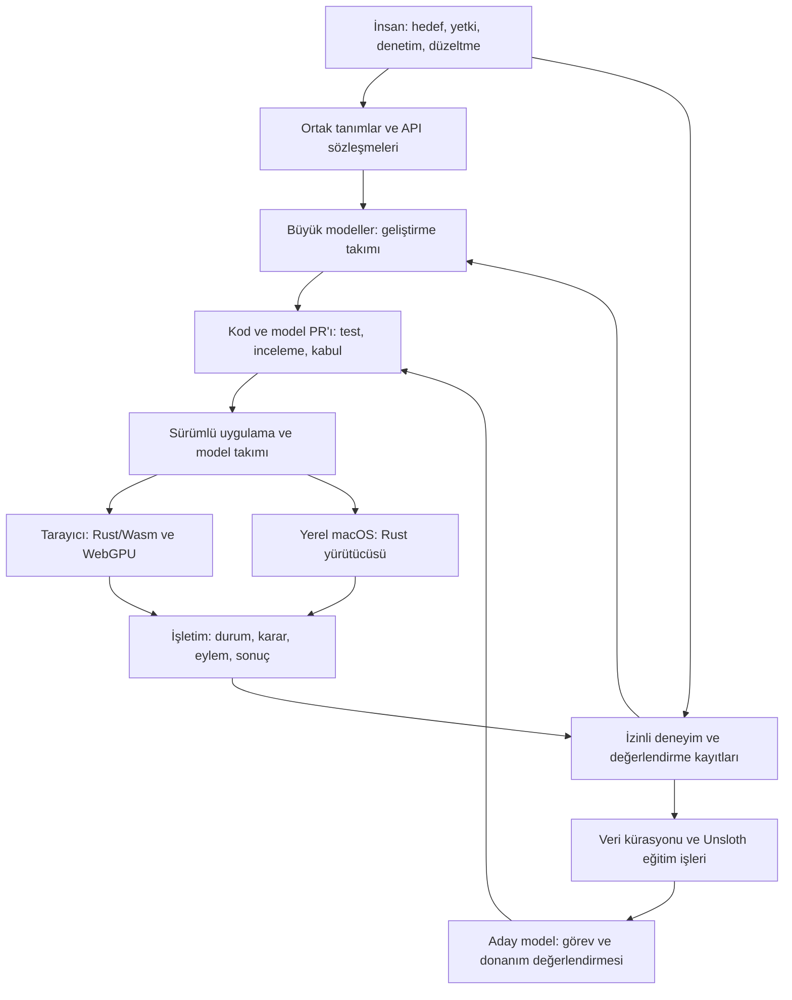

# Eylema — Basit, performanslı eylemci yapay zekâ web platformu — v0.4

Dil: Türkçe. Kaynak sürüm: 0.4.1. İngilizce kaynak belge: [Architecture v0.4](https://github.com/eylema-dev/eylema-docs-en/blob/main/docs/architecture.md). Kod, yorumlar, dosya adları, API işlem adları, şemalar, hata kodları ve katkı kayıtları İngilizce; rehber ve açıklamalar İngilizce ve Türkçe yayımlanır. Çeviri aynı sözleşme kimliklerini korur ve kaynak sürümüne bağlanır. Depo araçları çeviri dosya özetlerini ve API kimliği eşliğini denetler; kaydedilmemiş değişiklikler hata verir. Anlamsal eşdeğerlik yine inceleme gerektirir.

Tarih: 12 Ekim 2026. Ürün: **Eylema**. Ürün çerçevesi: **Basit, Performanslı Eylemci Yapay Zeka Sürekli Geliştirme ve İşletme Web Platformu.** Durum: uygulanan görev çekirdeği gelişen ürün mimarisi. [Çekirdek kanıtı](https://github.com/eylema-dev/eylema/blob/main/README.tr.md) mevcut yürütüm kapsamını belirtir; model, eğitim ve tam ürün kabulü ayrıdır.

Bu belge güncel mimari yönü tanımlar. v0.2’deki kendi Rust bileşenleri ve bağımlılık sınırı korunur; 3B, decision/world modelleri, Unsloth eğitim hattı ve insan denetimi tasarımın birinci sınıf parçaları olur. Geliştirme sırası aşağıda güncellenmiştir.

## Kabul edilen ilk ürün kararları

12 Ekim 2026 tarihli [karar kaydı ve donanım envanteri](project-structure.md), geliştirici odaklı tek kullanıcılı yerel görev konsolunu, erken ihtiyaçtan PR’a kanıtı ve kendi kaynak/belgelerimiz için Apache-2.0 seçimini kaydeder. Birincil M4 Pro hedefi korunur; Mac mini M4 ve Linux RTX 4070 Ti Super ayrı kabul bekleyen ek cihazlardır. Mevcut Rust tipleri, EYL/EYLJ ve platform bağları korunur; model/öğrenme deterministik ve cihaz ölçümünü izler. Güncel uygulama kanıtı [çekirdektedir](https://github.com/eylema-dev/eylema/blob/main/README.tr.md).

## Kabul edilmiş deneysel macOS kapsamı

İlk sürüm 24 GB birleşik belleğe sahip tek Apple M4 Pro MacBook Pro cihazını hedefler. G04 özgün macOS 27.0.1 toolchain/SDK/tarayıcı envanterini kaydeder; her yeni kabul çalışması gerçek ortamını ve yürütümünü ayrıca kaydetmelidir. Linux desteği ve ikinci fiziksel cihaz ertelenmiştir. Bu Mac'te ölçülen farklı iş yükleri birden fazla cihaz sayılmaz. Bu ürün belgesi deposu dokümantasyon aşamasında kalır; güncel runtime kanıtı çekirdeğe aittir ve ek hedef seçmek desteği kanıtlamaz.

| Yüzey | İlk sürüm sözleşmesi |
|---|---|
| Yerel hizmet ve CLI | Kendi Rust 1.99.0 bileşenleri, aarch64-apple-darwin; deterministik yürütücü, dayanıklı journal ve loopback web hizmeti |
| Model ve tensör işleri | Kendi Rust CPU referansı ve Metal üzerinden native_gpu; açık platform bağları, nesne ömrü ve unsafe sınırı envanteri |
| Tarayıcı görünümü | Taşınabilir Rust/Wasm ve WGSL ile WebGPU; native sunucu/dosya sistemi paketleri Wasm derlemesine dahil edilmez |
| Eğitim | Bu Mac'te ayrı sabitlenmiş yerel Unsloth Studio/MLX tarifi; export etkinleşmeden kendi Rust kabulünden geçer |
| Geliştirme | Gerçek Codex/Claude adaptörleri ve GitHub açıkça çevrimiçidir; yerel işletim/eğitim gizlice hosted modele çağrı yapmaz |

HardwareProfile tek fiziksel cihazı ve gözlenen kapasiteyi belirtir. WorkloadProfile aynı cihazdaki yürütüm hedefi, backend, GPU API ve kesin iş yükü/ortam sürümlerini belirtir. Atama ve kanıtlar model-set şema 0.2.0 üzerinden iki kimliği birlikte bağlar; tarihsel 0.1.0 şeması değişmez. Yinelenmiş/kopuk kimlikler, gerçek kapasite, kaynak/hash güveni ve kanıt kapsamı anlamsal doğrulama gerektirir; yapısal JSON kontrolü bunları kanıtlamaz.

Tarayıcı kapanması yerel yürütücüyü veya Metal işçisini sonlandırmaz. Yeniden açılış güncel snapshot/olaylara bağlanır. Yerel oturum Host/Origin, CSRF, istek boyut/süre ve kapsamlı yetki kontrollerini uygulamalıdır. Kalıcı durum varsayılan olarak macOS Application Support içindeki Eylema dizininde tutulur; onay cevabı dayanıklı journal yazımından sonra verilir. Kimlik bilgileri, ham özel eğitim kayıtları ve gizli model muhakemesi normal olay kaydına girmez. Rastgelelik/hash için yeni kriptografi yerine standart macOS hizmetleri kullanılır. macOS, SDK, tarayıcı, sürücüler, host bağları, Metal shader ve WGSL açık bağımlılıklar olarak kalır.

## Ürünün merkezindeki fikir

Uygulama; durumunu, hedeflerini, eylemlerini, yetkilerini, kaynak bütçesini ve kabul koşullarını tanımlar. Büyük modeller bu tanıma göre uygulamayı geliştirir. Yerel eylemciler kabul edilmiş sürümü işletir. Gerçek sonuçlar ve insan düzeltmeleri, sonraki geliştirme ve eğitim çalışmaları için kanıt üretir.

Basitlik, uygulama geliştiricisinin gördüğü sözleşmede ve kurulumdadır. İçerideki renderer, tensor motoru veya veri katmanının bütün karmaşıklığını ortadan kaldırdığımız anlamına gelmez. Normal web sayfası yalnız ihtiyaç duyduğu modülleri kullanır; 3B, yerel LLM ve dünya modeli her uygulamaya zorunlu yüklenmez.

Tamamen AI ile geliştirme/işletme hedefi; kod yazma, test, inceleme, görev yürütme ve iyileştirme işlerini yetkilendirilmiş AI ekiplerinin yapabilmesidir. İnsanlar hedef, yetki ve kabul politikasını belirler. Her karede veya her istek için LLM çağırmak gerekmez. Deterministik Rust kodu da bu AI ekibinin ürettiği ve kullandığı temel yürütme yoludur.

## Topoloji



Tarayıcı ve native node aynı sözleşmelerle farklı iş parçalarını yürütür. Aynı işlemi iki kez uygulamamak için görev kimliği, sahiplik ve tekrar teslim kuralları kullanılır. Browser–native bağlantısı ayrıca kimlik, izin ve veri aktarım sınırına sahiptir; ortak protokol ortak bellek veya sınırsız cihaz erişimi sağlamaz.

## Küçük çekirdek, seçilebilir yetenekler

| Bölüm | Sorumluluk |
|---|---|
| Tanımlar ve araçlar | Tipli uygulama grafiği; aynı kaynaktan CLI, API, AI araçları ve dokümantasyon |
| Web ve veri | HTML/DOM, olaylar, sunucu işlemleri, kimlik/yetki, kalıcılık ve sorgu sözleşmeleri |
| Eylemci yürütmesi | Durum, görev, kuyruk, zaman sınırı, yetki, eylem ve sonuç |
| Hesaplama ve 3B | CPU referansları, GPU işleri, tensorler, sahne ve kaynak yönetimi |
| Model işletimi | Dil, algı, karar ve dünya modelleri; donanıma göre kabul edilmiş takım ataması |
| Geliştirme ve öğrenme | Büyük model ekibi, PR akışı, veri kürasyonu, eğitim ve sürüm değerlendirmesi |

Bunlar mantıksal sınırlar; her biri ayrı servis veya büyük bağımlılık ağacı olmak zorunda değildir. Framework’ün UI, sunucu, veri ve hesaplama motorları kendi Rust kodumuz olarak geliştirilir. Leptos, SQLx, wgpu, Burn gibi hazır motorlar varsayılan üretim bağımlılığı yapılmaz.

İlk üretim çekirdeğinde üçüncü taraf Cargo paketi olmaması hedefi sürer. Rust araç zinciri, tarayıcı, işletim sistemi, GPU sürücüsü ve model ağırlıkları görünür platform bağımlılıklarıdır. Kullanıcının seçtiği **Unsloth, eğitim/paketleme ortamının açık dış bağımlılığıdır**; bu ortamın Python ve hızlandırıcı kitaplıkları ayrı envanter ve sabitlenmiş sürümler taşır. Bu nedenle bütün geliştirme ve eğitim zinciri için “yalnız Rust bağımlılığı” denmez.

## Model takımı

| Yetenek | İşletimdeki görevi | Çıktısı |
|---|---|---|
| Dil modeli | İsteği anlamlandırma, açıklama, uzun bağlamlı görev çözümleme | Yapılandırılmış görev/öneri |
| Algı modeli | Görüntü, ses veya başka gözlemleri yorumlama | Gözlem ve kestirilen durum |
| Dünya modeli | Bir eylemin olası sonraki durumlarını tahmin etme | Gelecek durum/temsil, maliyet, sonlanma ve varsa kalibre edilmiş belirsizlik |
| Karar modeli | Hedef ve kısıtlara göre eylem seçme veya puanlama | Politika çıktısı, değer veya aday sıralaması |
| Planlayıcı | Olası eylem dizilerini arama/optimize etme | Sınırlı ufukta plan |
| Rust yürütücüsü | İzin verilen eylemi uygulama ve gözlenen sonucu kaydetme | Gerçek yürütme sonucu |

Bir model birden fazla rol üstlenebilir. Karar katmanı öğrenilmiş politika, değer ağı, deterministik kurallar/arama veya bunların birleşimini kullanabilir. Dünya modeli her karar için zorunlu değildir; ölçülebilir yarar sağladığı işlerde etkinleşir.

```text
Gözlem → Durum kestirimi → Dünya modelinde aday gelecekler
                ↓                         ↓
Hedef/kısıt → Karar modeli ve planlayıcı → Eylem önerisi
                                          ↓
                             Yetki ve durum doğrulaması
                                          ↓
                              Gerçek eylem → Yeni gözlem
```

Üç durum alanı ayrı tutulur: **gözlenmiş/otoritatif uygulama durumu**, **kestirilen durum** ve **hayal edilen olası gelecek**. Tahmin, kendiliğinden kalıcı gerçek durum olarak yazılmaz. Eylem eski bir durum sürümüne dayanıyorsa yeniden doğrulanır.

Model sözleşmesi; gözlem/eylem şemasını, normalizasyonu, zaman adımını, koordinatları/birimleri, geçerlilik süresini, recurrent durumun sahipliğini, reset kurallarını ve tahmin ufkunu içerir. Dünya modeli değişince politika da yeniden sınanır; eski latent durumun yeni modele doğrudan taşınacağı varsayılmaz.

DreamerV3, öğrenilmiş dünya modeli ve hayal edilen yörüngelerle politika öğrenimine örnektir. MuZero, planlama için değer/politika/ödül tahminini öğrenilmiş dinamiklerle birleştirir. Bunlar bizim platformda hazır destek veya genel fizik doğruluğu kanıtı değildir. [DreamerV3](https://github.com/danijar/dreamerv3), [MuZero](https://deepmind.google/blog/muzero-mastering-go-chess-shogi-and-atari-without-rules/)

Güncel Cosmos ailesi dünya muhakemesi, üretim ve eyleme bağlı model/politika örnekleri içerir. Görsel olarak ikna edici gelecek üretimi yine de bizim eylem sözleşmemiz ve kapalı döngü görev testimizden ayrı değerlendirilir. [NVIDIA Cosmos](https://github.com/NVIDIA/cosmos/blob/main/README.md)

## 3B ve WebGPU tasarımı

İlk 3B hedef; etkileşimli sahne, kamera, nesne seçimi/dönüşümü, malzeme, ışık, varlık yükleme, instancing ve görünmeyen işleri elemedir. Büyük sahneler için ayrıntı düzeyi ve akışla yükleme ihtiyaçla eklenir. Hassas CAD geometrisi, kısıt çözücü, tam fizik ve video üreten dünya modeli ayrı özellik alanlarıdır; bir sahneyi çizmek bunları tamamlamış sayılmaz.

**Ortak GPU kaynak yöneticisi**; render, LLM çıkarımı, karar modeli ve world-model rollout işlerini birlikte bütçeler. Ağırlıklar, KV/recurrent durum, ara tensorler, texture/mesh kaynakları ve aktarım tamponları aynı cihaz hesabına girer. Uyumlu işler aynı aygıt bağlamında, izin verilen kullanım ve yerleşimlerle kaynak paylaşabilir; bütün işler arasında sıfır kopya garantisi verilmez.

Render, hızlı karar, dil üretimi ve gelecek tahmini farklı sıklıklarda çalışır. Parçalanabilen hesaplar kısa işlere bölünür; bekleyen işler ve eşzamanlılık sınırlandırılır. Yöneticinin yeni işleri sıralaması, başlatılmış keyfî GPU işini anında kesebilmesi anlamına gelmez. Sahne için seçilen kare bütçesi aşılırsa model/sahne profiline göre çıkarım sıklığı, rollout ufku veya görsel kalite ayarlanır. Kaliteyi düşürmek yalnız o profilin kabul sınırlarında mümkündür.

Örneğin 60 FPS hedefinin toplam kare süresi yaklaşık 16,7 ms’dir; bu bir cihaz ölçümü veya garanti değildir. Kabul; model boşta iken FPS üzerinden değil, birlikte çalışan sahne ve model takımında frame-time p95/p99, görev kalitesi, karar gecikmesi, bellek ve yükleme maliyeti üzerinden yapılır.

WebGPU ve WGSL, tarayıcıdaki grafik ve hesaplama yolunu tanımlar. Rust/Wasm GPU shader’ının kendisi değildir: kendi dar hesaplama tanımımızın desteklenen işlemlerinden WGSL üretmek, gerektiğinde düşük seviyeli shader erişimi sunmak gerekir. Bütün Rust dilini otomatik GPU diline çevirmek ilk hedef değildir. [WebGPU](https://www.w3.org/TR/webgpu/), [WGSL](https://www.w3.org/TR/WGSL/)

WebLLM, WebGPU üzerinde yerel dil modeli çalıştırmanın ve worker üzerinden arayüzden ayrılmanın uygulanabilir örneğidir. Bu yaklaşım kendi motorumuzda mimari, tokenizer, attention/KV, nicemleme ve GPU kernel işini ortadan kaldırmaz. Worker da GPU kapasitesini artırmaz. [WebLLM](https://webllm.mlc.ai/docs/)

Browser ve native GPU yolları ayrı destek profilleridir. CubeCL’nin platform karşılaştırması da plain WebGPU ile native hızlandırma yollarının aynı özellikleri sunmadığını gösterir. Sürücü/bellek/özellik sorguları ve gerçek ölçüm seçimde belirleyicidir. [CubeCL platformları](https://github.com/tracel-ai/cubecl#supported-platforms)

## Donanıma göre takım ve sürümler

Seçim: `iş yükü → desteklenen model/operator/format → kalite eşiği → kaynak bütçesi → ortak sahne ölçümü → kabul edilmiş takım`.

Çalışan cihaz yalnız kabul edilmiş `ModelSetRelease` içindeki seçenekleri atar. Model, nicemleme, motor veya davranış sözleşmesinin değişmesi yeni aday sürümdür. Yeni kaynakların keşfi değerlendirme başlatabilir; yeni çıkan her model otomatik etkinleşmez. PR, değerlendirme, kontrollü dağıtım ve geri dönüş bağımsız kayıtlarla izlenir.

Her model için dört destek aşaması kullanılır: tanımlandı; referans çıktıyla doğrulandı; belirtilen yerel yürütücüde çalıştırıldı; belirli sahne/takım/donanım birleşiminde kabul edildi. Eğitim desteği ayrıca belirtilir. LLM desteği Conv, recurrent durum veya diffusion desteklediğimiz anlamına gelmez. Kendi motorumuz için henüz hiçbir model çalışıyor diye sınıflandırılmamıştır.

İşletim protokolü, model takımı, cihaz ataması, davranış sözleşmesi, eğitim verisi, eğitim tarifi ve değerlendirme seti ayrı sürümlenir. Olaylar bunların bağını taşır. Ortam değiştiğinde ilgili uyumluluk kanıtı yeniden değerlendirilir.

## Sürekli öğrenme ve ekosistem

İzinli deneyim kaydı; bağlamı, gözlemi, önerilen/uygulanan eylemi, gerçek sonucu, maliyeti ve insan düzeltmesini ilişkilendirir. Ham kayıt önce temizleme, köken/izin, tekrar eleme ve kalite değerlendirmesinden geçer. Başarısızlıklar ve düzeltmeler yanında temsili başarılı örnekler de tutulur; modelin kendi yanıtı otomatik doğru etiket sayılmaz.

Dil görevi örnekleri, karar yörüngeleri, dünya modeli geçişleri ve donanım performans ölçümleri farklı veri sözleşmeleri kullanır. Eğitim/test ayrımı ilişkili oturum, zaman ve görevler üzerinden yapılır. Veri toplama izinleri görev yürütme yetkisinden ayrıdır; platformu kullanmak veriyi topluluk eğitimine açmak anlamına gelmez.

Unsloth için sabitlenmiş eğitim tarifleri hazırlanır. Desteklenen mimari/yöntem seçilir, eğitim ayrı kaynak bütçesiyle yapılır; export edilen aday kendi Rust CPU/GPU yolunda sayısal uyum ve görev testlerinden geçer. Unsloth’un fine-tuning/RL ve dışa aktarım desteği her özel dünya modeline veya bizim engine’e otomatik uyum sağlamaz. [Unsloth](https://github.com/unslothai/unsloth), [dışa aktarım sorunları](https://docs.unsloth.ai/basics/saving-and-using-models/troubleshooting)

Topluluk; izinli veri paketleri, etiketleme kuralları, görev/değerlendirme paketleri, eğitim tarifleri, model paketleri, donanım profilleri ve Rust kernel katkıları sunabilir. Her katkı köken, kullanım koşulu, sürüm ve yeniden üretilebilir kanıt taşır. Özel ham veri ve gizli test setleri public pakete kendiliğinden dönüşmez.

## İnsan ve AI için ortak API

API proje teslimatının temel parçasıdır. Aynı tipli sözleşme Rust SDK, HTTP, olay akışı, CLI ve AI araçlarına temel olur; insan rehberi ve makinece okunabilir yetenek şemaları buradan türetilir. OpenAPI/JSON Schema gibi biçimler, harici üretim motoru kullanma zorunluluğu getirmez.

| İnsan ilişkisi | Sözleşmeye yansıması |
|---|---|
| Human-in-the-loop | Politikanın gerektirdiği eylem, belirli plan/girdi/durum sürümüne bağlı insan kararı bekler |
| Human-on-the-loop | İnsan yürütmeyi ve gerekçeli sonuçları izler, müdahale/durdurma isteği gönderir; durumun sonucu doğrulanır |
| Human-in-command | İnsan hedefi, yetki sınırını, bütçeyi, devir ve geri alma politikasını belirler |

Bu biçimler aynı uygulamada eylem bazında birlikte kullanılabilir. Her düşük etkili adımda yeniden onay almak zorunlu değildir. Geçerli yetki içinde AI işler; sınır dışındaki eylem açıkça durur. İptal, gerçekleşmiş dış etkiyi otomatik geri almaz.

Doküman her işlem için amaç, girdi/çıktı, önkoşul, yan etki, yetki, zaman aşımı, tekrar deneme, idempotency, insan denetimi ve hata durumunu kapsar. Gerçek uygulama geliştirildiğinde örnekler CI’de derlenip/çalıştırılıp sürüme bağlanır; şimdiki örnekler önerilen sözleşmedir.

## Geliştirme sırası ve ilk somut ürün kanıtı

| Dilim | Teslim | Kabul kanıtı |
|---|---|---|
| 0 | Dar hedef, API/durum/eylem sözleşmeleri, destek ve bağımlılık matrisi | Aynı ihtiyacı insan ve AI araçlarının tutarlı okuyabilmesi |
| 1a | Rust görev sözleşmeleri, deterministik yürütücü ve yerel günlük | Yetkili yürütme, sınırlı iş, doğru iptal bildirimi ve yeniden başlatma sonrası kurtarma |
| 1b | Asgari web arayüzü ve yerel ana hizmet | Tarayıcıda görev oluşturma, çalıştırma, inceleme, durdurma, kaydetme ve yeniden açma |
| 1c | Erken ve sınırlı ihtiyaçtan PR’a iş akışı kanıtı | Gerçek kapsamlı görev, kontroller, ayrı inceleme ve gerçek PR; otonom adaptör desteği kendi yürütümünü gerektirir |
| 1d | Seçilebilir WebGPU 3B sahne | Nesne hareketi ve gerçek tarayıcı/cihaz yürütmesi |
| 2 | Deterministik karar başlangıcı + kendi tensor işlemleri + küçük öğrenilmiş politika/dinamik model | Tahmin–gerçek farkı, kapalı döngü başarı ve CPU/GPU uyum testi |
| 3 | Desteklenen bir küçük yerel dil modeli ve ortak GPU yönetimi | LLM + karar + sahne aynı cihazda hedef kalite/kaynak sınırında |
| 4 | Deneyim kaydı, insan düzeltmesi, ilk Unsloth tarifi ve model kabulü | Kaydı modele kadar izlenen, ayrılmış görevlerde ölçülen iyileşme |
| 5 | Büyük AI geliştirme takımı, GitHub PR ve donanıma göre takım sürümü | Gerçek ihtiyaçtan PR’a; tek fiziksel Mac üzerinde iki iş yükünde gerekçeli atama |
| 6 | Üretim web özellikleri ve açık katkı ekosistemi | Seçilen üretim protokolleri ve bağımsız katkıların uyumluluk kanıtı |

API ve değerlendirme tanımları her dilimin içindedir. Bakımcı, ilk çalışan uygulama olarak görev çekirdeği ve web akışını seçti. [Proje yapısı ve kabul senaryoları](project-structure.md) önerilen uygulamayı açıklar. Küçük bir 3B depo/yerleştirme ortamı bu kanıttan sonra gelir; öğrenilmiş kararlar ve doğal dil hedefleri sonraki aşamalarda eklenir. Güncel çekirdek kanıtı uygulanan görev konsolu alt kümesini kaydeder; sonraki yetenekler ayrı kabul gerektirir.

Tam özellikli kendi web motoru, 3B motor, model yürütücüsü ve eğitim ekosistemi ciddi bir kapsamdır. AI ekipleri geliştirmeyi hızlandırabilir; donanım doğrulaması ve olgunlaşma ihtiyacını ortadan kaldırmaz. Dilimler bu nedenle çalıştırılmış kanıtla genişler; “her model/her cihazda sorunsuz” taahhüdü verilmez.

## Ayrıntılı sözleşmeler

- [Geliştirme ve yerel işletim takımı protokolleri](development-and-operations.md)
- [Öğrenme verisi ve eğitim protokolü](learning-and-training.md)
- [API sözleşmesi ve insan denetimi](api-reference.md)
- [Geliştirme isteği JSON şeması](https://github.com/eylema-dev/eylema/blob/main/ai-team-protocol/request.schema.json)
- [Yerel model takımı JSON şeması](https://github.com/eylema-dev/eylema/blob/main/ai-team-protocol/v0.2/model-set-release.schema.json)

Bu belgeler mimari ve yapısal sözleşme teslimidir. Depo katkı araçları ve PR çalışması, planlanan otonom geliştirme takımından ayrıdır. Bu belgeler eğitim, model/cihaz kıyası, framework yürütmesi veya zamanlanmış izleme kanıtı sunmaz.
