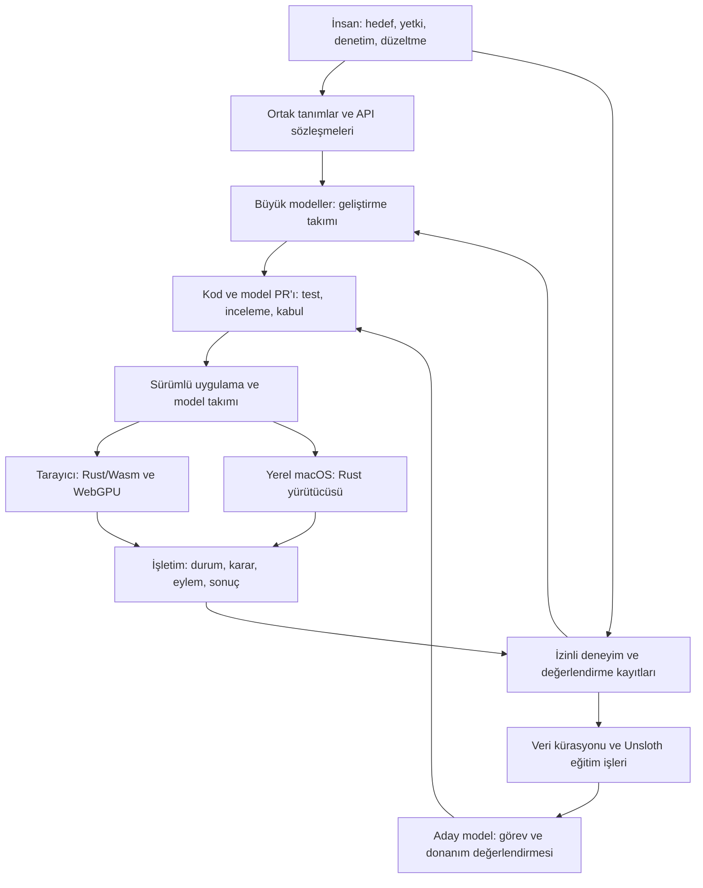
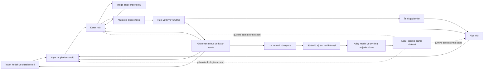

# Eylema — Basit, performanslı eylemci yapay zekâ web platformu — v0.7

Dil: Türkçe. Kaynak sürüm: 0.7.0. İngilizce kaynak belge: [Architecture v0.7](https://github.com/eylema-dev/eylema-docs-en/blob/main/docs/architecture.md). Kod, yorumlar, dosya adları, API işlem adları, şemalar, hata kodları ve katkı kayıtları İngilizce; rehber ve açıklamalar İngilizce ve Türkçe yayımlanır. Çeviri aynı sözleşme kimliklerini korur ve kaynak sürümüne bağlanır. Depo araçları çeviri dosya özetlerini ve API kimliği eşliğini denetler; kaydedilmemiş değişiklikler hata verir. Anlamsal eşdeğerlik yine inceleme gerektirir.

Tarih: 13 Ekim 2026. Ürün: **Eylema**. Ürün çerçevesi: **Basit, Performanslı Eylemci Yapay Zeka Sürekli Geliştirme ve İşletme Web Platformu.** Durum: uygulanan görev çekirdeği gelişen ürün mimarisi. [Çekirdek kanıtı](https://github.com/eylema-dev/eylema/blob/main/README.tr.md) mevcut yürütüm kapsamını belirtir; model, eğitim ve tam ürün kabulü ayrıdır.

Bu belge güncel mimari yönü tanımlar. v0.2’deki kendi Rust bileşenleri ve bağımlılık sınırı korunur; 3B, decision/world modelleri, Unsloth eğitim hattı ve insan denetimi tasarımın birinci sınıf parçaları olur. Geliştirme sırası aşağıda güncellenmiştir.

## Kabul edilen ilk ürün kararları

12 Ekim 2026 tarihli [karar kaydı ve donanım envanteri](project-structure.md), geliştirici odaklı tek kullanıcılı yerel görev konsolunu, erken ihtiyaçtan PR’a kanıtı ve kendi kaynak/belgelerimiz için Apache-2.0 seçimini kaydeder. Birincil M4 Pro hedefi korunur; Mac mini M4 ve Linux RTX 4070 Ti Super ayrı kabul bekleyen ek cihazlardır. Mevcut Rust tipleri, EYL/EYLJ ve platform bağları korunur; model/öğrenme deterministik ve cihaz ölçümünü izler. Güncel uygulama kanıtı [çekirdektedir](https://github.com/eylema-dev/eylema/blob/main/README.tr.md).

## Kabul edilmiş deneysel macOS kapsamı

İlk sürüm 24 GB birleşik belleğe sahip tek Apple M4 Pro MacBook Pro cihazını hedefler. G04 özgün macOS 27.0.1 toolchain/SDK/tarayıcı envanterini kaydeder; her yeni kabul çalışması gerçek ortamını ve yürütümünü ayrıca kaydetmelidir. Linux desteği ve ikinci fiziksel cihaz ertelenmiştir. Bu Mac'te ölçülen farklı iş yükleri birden fazla cihaz sayılmaz. Bu ürün belgesi deposu dokümantasyon aşamasında kalır; güncel runtime kanıtı çekirdeğe aittir ve ek hedef seçmek desteği kanıtlamaz.

| Yüzey | İlk sürüm sözleşmesi |
|---|---|
| Yerel hizmet ve CLI | Kendi Rust 1.99.0 bileşenleri, aarch64-apple-darwin; deterministik yürütücü, dayanıklı journal ve loopback web hizmeti |
| Model ve tensör işleri | Kendi Rust CPU referansı ve Metal üzerinden native_gpu; açık platform bağları, nesne ömrü ve unsafe sınırı envanteri |
| Tarayıcı görünümü | Taşınabilir Rust/Wasm ve WGSL ile WebGPU; native sunucu/dosya sistemi paketleri Wasm derlemesine dahil edilmez |
| Eğitim | Bu Mac'te ayrı sabitlenmiş yerel Unsloth Studio/MLX tarifi; export etkinleşmeden kendi Rust kabulünden geçer |
| Geliştirme | Gerçek Codex/Claude adaptörleri ve GitHub açıkça çevrimiçidir; yerel işletim/eğitim gizlice hosted modele çağrı yapmaz |

HardwareProfile tek fiziksel cihazı ve gözlenen kapasiteyi belirtir. WorkloadProfile aynı cihazdaki yürütüm hedefi, backend, GPU API ve kesin iş yükü/ortam sürümlerini belirtir. Atama ve kanıtlar model-set şema 0.2.0 üzerinden iki kimliği birlikte bağlar; tarihsel 0.1.0 şeması değişmez. Yinelenmiş/kopuk kimlikler, gerçek kapasite, kaynak/hash güveni ve kanıt kapsamı anlamsal doğrulama gerektirir; yapısal JSON kontrolü bunları kanıtlamaz.

Tarayıcı kapanması yerel yürütücüyü veya Metal işçisini sonlandırmaz. Yeniden açılış güncel snapshot/olaylara bağlanır. Yerel oturum Host/Origin, CSRF, istek boyut/süre ve kapsamlı yetki kontrollerini uygulamalıdır. Kalıcı durum varsayılan olarak macOS Application Support içindeki Eylema dizininde tutulur; onay cevabı dayanıklı journal yazımından sonra verilir. Kimlik bilgileri, ham özel eğitim kayıtları ve gizli model muhakemesi normal olay kaydına girmez. Rastgelelik/hash için yeni kriptografi yerine standart macOS hizmetleri kullanılır. macOS, SDK, tarayıcı, sürücüler, host bağları, Metal shader ve WGSL açık bağımlılıklar olarak kalır.

## Ürünün merkezindeki fikir

**Eylema, birlikte çalışan agentic döngüleri tanımlama, çalıştırma ve geliştirme platformudur.** Bakımcı 13 Ekim 2026’da ürün amacını netleştirdi: döngüyü kurmak, modellerini değiştirmek ve eğitim için izinli veri toplamak. MiniCPM, Qwen ve yerel açık ağırlıklı karar modelleri değiştirilebilir katılımcılardır; sabit rollerin, sözleşmelerin ve yaşam döngüsünün sahibi platformdur. Görev konsolu bu platformun ilk arayüzü, mevcut deterministik çekirdek ise yürütme temelidir.

Uygulama gözlemlerini, durumunu, hedeflerini, eylemlerini, rol bağlantılarını, yetkilerini, kaynak bütçesini ve kabul koşullarını tanımlar. Yerel katılımcılar tipli öneriler paylaşır; yetkili yürütmenin ürettiği gözlemler sonraki kararı besler. Büyük modeller bu tanımları ve uygulamaları incelenen geliştirme iş akışında oluşturabilir. İnsan düzeltmeleri ve ölçülen sonuçlar sonraki veri kümesi ve model sürümlerini destekler.

Basitlik, uygulama geliştiricisinin gördüğü sözleşmede ve kurulumdadır. İçerideki renderer, tensor motoru veya veri katmanının bütün karmaşıklığını ortadan kaldırdığımız anlamına gelmez. Normal web sayfası yalnız ihtiyaç duyduğu modülleri kullanır; 3B, yerel LLM ve dünya modeli her uygulamaya zorunlu yüklenmez.

Tamamen AI ile geliştirme/işletme hedefi; kod yazma, test, inceleme, görev yürütme ve iyileştirme işlerini yetkilendirilmiş AI ekiplerinin yapabilmesidir. İnsanlar hedef, yetki ve kabul politikasını belirler. Her karede veya her istek için LLM çağırmak gerekmez. Deterministik Rust kodu da bu AI ekibinin ürettiği ve kullandığı temel yürütme yoludur.

## Topoloji



Tarayıcı ve native node aynı sözleşmelerle farklı iş parçalarını yürütür. Aynı işlemi iki kez uygulamamak için görev kimliği, sahiplik ve tekrar teslim kuralları kullanılır. Browser–native bağlantısı ayrıca kimlik, izin ve veri aktarım sınırına sahiptir; ortak protokol ortak bellek veya sınırsız cihaz erişimi sağlamaz.

## Küçük çekirdek, seçilebilir yetenekler

| Bölüm | Sorumluluk |
|---|---|
| Tanımlar ve araçlar | Tipli uygulama grafiği; aynı kaynaktan CLI, API, AI araçları ve dokümantasyon |
| Web ve veri | HTML/DOM, olaylar, sunucu işlemleri, kimlik/yetki, kalıcılık ve sorgu sözleşmeleri |
| Eylemci yürütmesi | Durum, görev, kuyruk, zaman sınırı, yetki, eylem ve sonuç |
| Hesaplama ve 3B | CPU referansları, GPU işleri, tensorler, sahne ve kaynak yönetimi |
| Model işletimi | Dil, algı, karar ve dünya modelleri; donanıma göre kabul edilmiş takım ataması |
| Geliştirme ve öğrenme | Büyük model ekibi, PR akışı, veri kürasyonu, eğitim ve sürüm değerlendirmesi |

Bunlar mantıksal sınırlar; her biri ayrı servis veya büyük bağımlılık ağacı olmak zorunda değildir. Framework’ün UI, sunucu, veri ve hesaplama motorları kendi Rust kodumuz olarak geliştirilir. Leptos, SQLx, wgpu, Burn gibi hazır motorlar varsayılan üretim bağımlılığı yapılmaz.

İlk üretim çekirdeğinde üçüncü taraf Cargo paketi olmaması hedefi sürer. Rust araç zinciri, tarayıcı, işletim sistemi, GPU sürücüsü ve model ağırlıkları görünür platform bağımlılıklarıdır. Kullanıcının seçtiği **Unsloth, eğitim/paketleme ortamının açık dış bağımlılığıdır**; bu ortamın Python ve hızlandırıcı kitaplıkları ayrı envanter ve sabitlenmiş sürümler taşır. Bu nedenle bütün geliştirme ve eğitim zinciri için “yalnız Rust bağımlılığı” denmez.

## Model takımı

| Yetenek | İşletimdeki görevi | Çıktısı |
|---|---|---|
| Dil modeli | İsteği anlamlandırma, açıklama, uzun bağlamlı görev çözümleme | Yapılandırılmış görev/öneri |
| Algı modeli | Görüntü, ses veya başka gözlemleri yorumlama | Gözlem ve kestirilen durum |
| Dünya modeli | Bir eylemin olası sonraki durumlarını tahmin etme | Gelecek durum/temsil, maliyet, sonlanma ve varsa kalibre edilmiş belirsizlik |
| Karar modeli | Hedef ve kısıtlara göre eylem seçme veya puanlama | Politika çıktısı, değer veya aday sıralaması |
| Planlayıcı | Olası eylem dizilerini arama/optimize etme | Sınırlı ufukta plan |
| Rust yürütücüsü | İzin verilen eylemi uygulama ve gözlenen sonucu kaydetme | Gerçek yürütme sonucu |

Bir model birden fazla rol üstlenebilir. Karar katmanı öğrenilmiş politika, değer ağı, deterministik kurallar/arama veya bunların birleşimini kullanabilir. Dünya modeli her karar için zorunlu değildir; ölçülebilir yarar sağladığı işlerde etkinleşir.

```text
Gözlem → Durum kestirimi → Dünya modelinde aday gelecekler
                ↓                         ↓
Hedef/kısıt → Karar modeli ve planlayıcı → Eylem önerisi
                                          ↓
                             Yetki ve durum doğrulaması
                                          ↓
                              Gerçek eylem → Yeni gözlem
```

Üç durum alanı ayrı tutulur: **gözlenmiş/otoritatif uygulama durumu**, **kestirilen durum** ve **hayal edilen olası gelecek**. Tahmin, kendiliğinden kalıcı gerçek durum olarak yazılmaz. Eylem eski bir durum sürümüne dayanıyorsa yeniden doğrulanır.

Model sözleşmesi; gözlem/eylem şemasını, normalizasyonu, zaman adımını, koordinatları/birimleri, geçerlilik süresini, recurrent durumun sahipliğini, reset kurallarını ve tahmin ufkunu içerir. Dünya modeli değişince politika da yeniden sınanır; eski latent durumun yeni modele doğrudan taşınacağı varsayılmaz.

DreamerV3, öğrenilmiş dünya modeli ve hayal edilen yörüngelerle politika öğrenimine örnektir. MuZero, planlama için değer/politika/ödül tahminini öğrenilmiş dinamiklerle birleştirir. Bunlar bizim platformda hazır destek veya genel fizik doğruluğu kanıtı değildir. [DreamerV3](https://github.com/danijar/dreamerv3), [MuZero](https://deepmind.google/blog/muzero-mastering-go-chess-shogi-and-atari-without-rules/)

Güncel Cosmos ailesi dünya muhakemesi, üretim ve eyleme bağlı model/politika örnekleri içerir. Görsel olarak ikna edici gelecek üretimi yine de bizim eylem sözleşmemiz ve kapalı döngü görev testimizden ayrı değerlendirilir. [NVIDIA Cosmos](https://github.com/NVIDIA/cosmos/blob/main/README.md)

## İşbirlikli agentic döngü ve sabit platform sözleşmeleri

Bu revizyon, 13 Ekim 2026’da istenen platform tasarımını tanımlar. Aşağıdaki bütünleşme bir öneridir; kurulmuş veya runtime kabulü geçmiş değildir. Mevcut görev, model ve Goal kanıtlarının kapsamı korunur. Özellikle bu tasarım sağlayıcı adaptörünü düzeltmez veya G40 kabulünü sağlamaz.

### Önce döngüyü kur, sonra modelleri ata

Eylema sürümlü döngü tanımı, rol sözleşmesi kayıt sistemi, model/adaptör kataloğu, yürütme konsolu, kanıt deposu ve veri kümesi oluşturucu sağlar. Geliştirici rolleri bağlar, eylem/gözlem şemalarını ve bütçeleri tanımlar, uyumlu yerel modelleri seçer, kabul edilmiş yapılandırmayı çalıştırıp inceler. Aynı döngü, uygulama mantığı yeniden yazılmadan farklı ağırlık veya model aileleri kullanabilir.

Üç yaklaşım değerlendirildi: her rolü tek çok kipli modelin üstlenmesi; eylemciler arasında sınırsız konuşma; tipli işbirlikli döngü. Önerilen döngü uzman rolleri ayrı ayrı değiştirilebilir tutar, yürütmeyi sınırlar ve deterministik başlangıçlarla kıyaslamayı sağlar. Kabul edilmiş ölçümler uygunsa tek model örneği birden fazla rolü üstlenebilir; her rol ayrı süreç veya sürekli bellekte yüklü model gerektirmez.

| Rol | İlk aday veya mekanizma | Döngüye katkısı |
|---|---|---|
| Algı | MiniCPM-V; isteğe bağlı, ayrıca değerlendirilen MiniCPM-o profili | İzinli görüntü/video/sesi kaynağa bağlı gözlemlere ve belirsizliği belirtilen durum kestirimlerine dönüştürür |
| Niyet ve planlama | Qwen ailesi; mevcut iş için sabit Qwen3-0.6B başlangıcı korunur | EN/TR hedefleri yorumlar, sınırlı plan önerir, eksik kanıt ister |
| Karar | Yerel açık ağırlıklı politika, değer/sıralama modeli veya göreve eğitilmiş Decision Transformer | İzin verilebilir eylemleri hedef, güncel kanıt ve kısıtlara göre puanlar; kabul edilen alanın dışında karar vermekten kaçınır |
| Öngörü | İsteğe bağlı, göreve özgü dinamik/dünya modeli | Aday eylemlerin sonuçlarını kestirir; tahminleri gözlemlerden ayrı tutar |
| İş akışı | Önerilen yerel XState koordinatörü | Sürümlü durum çizelgesiyle rol işlerini, beklemeleri, son süreleri, tekrarları ve sonuç uzlaştırmasını yönetir |
| Yürütme ve yetki | Kendi Rust çekirdeğimiz ve EYL/EYLJ | Güncel durumu, yetenekleri, onayları ve bütçeleri doğrular; gerçek sonuçları yürütüp kalıcılaştırır |
| Açıklama ve değerlendirme | Yapılandırılmış karar kanıtı ve göreve özgü değerlendiriciler | Eylemin neden önerildiğini, neden izin verildiğini/reddedildiğini ve gerçekte ne olduğunu gösterir |

Bakımcı “Jev” ile yerelde çalışan açık ağırlıklı karar modellerini kastettiğini netleştirdi. Bu ad seçilmiş bir ürün, paket veya checkpoint değildir. Decision Transformer, görev yörüngelerinden eğitilen çevrimdışı dizi tabanlı politika örneğidir; yayımlanan bir mimari veya başka ortama ait checkpoint, Eylema için genel karar motoru sayılmaz. Göreve eğitilmiş küçük politika/sıralayıcı ve deterministik arama karşılaştırma başlangıçlarıdır. MiniCPM ve Qwen adayları da yürütmeden önce kesin artifact, tokenizer/ön işleme, operatör, hak ve backend profili gerektirir. Kaynak aileler aday yetenekleri gösterir; bizim uyumluluğumuzu veya Türkçe görev kalitesini kanıtlamaz. [MiniCPM](https://github.com/OpenBMB/MiniCPM-V), [Qwen3](https://qwenlm.github.io/blog/qwen3/), [Decision Transformer makalesi](https://arxiv.org/abs/2106.01345), [resmî uygulama](https://github.com/kzl/decision-transformer).



Birlikteliğin gücü geri beslemededir: algı planı kanıta bağlar; politika somut seçenekleri karşılaştırır; yürütme seçimi gerçeklikle sınar; sonraki plan/karar adımı gözlenen farkı ve düzeltmeleri kullanır. Uyuşmazlık veya yetersiz kanıt yeni gözlem, sınırlı yeniden planlama ya da insan girdisi gerektirir. Modellerin anlaşması bağımsız doğruluk kanıtı değildir. Bir iş akışı turunun adım, çıkarım, gözlem, süre ve kaynak bütçeleri sonludur; sınırda yeni ve sınırsız bir döngü yerine kayıtlı durma koşuluna geçilir.

İki zaman ölçeği vardır. İşletim döngüsü sabit kabul edilmiş atamayı kullanır; eylem sürerken eğitim yapmaz veya modeli sessizce değiştirmez. İyileştirme döngüsü bölümleri kürasyondan geçirir, aday eğitir, değerlendirir ve yeni sürüm önerir. Eğitim ve etkinleştirme kendi izinli girdilerini, kaynaklarını ve kabulünü gerektirir. Seçilebilir dünya modeli döngüsünün de sınırlı ufku vardır; hayal edilen sonuçlar gerçek olarak yazılamaz.

### Sabit sözleşmeler, değiştirilebilir uygulamalar

| Sabit platform öğesi | Model değiştiğinde korunacak sözleşme |
|---|---|
| Döngü tanımı | Rol grafiği, durum çizelgesi sürümü, izinli eylemler, sonlanma koşulları ve bütçeler |
| Rol arayüzü | Tipli girdi/çıktı, birimler, eylem uzayı, ön işleme, zaman anlamı, geçerlilik, belirsizlik ve sıfırlama kuralları |
| Yetki | Öneri izin veremez; yürütme kimliği, durum sürümünü, politikayı ve gereken onayı yeniden kontrol eder |
| Kalıcı kimlik | Görev, bölüm, adım, öneri ve yürütme kimlikleri; sıralı olay imleci ve sonuç uzlaştırması |
| Kanıt | Kaynak referansları, gerçek model/backend sürümleri, kısıtlar, aday puanları, sonuç ve açıklama durumu |
| Veri kümesi kökeni | Toplama izni, amaç, dönüşümler, etiket/düzeltme geçmişi, bölümleme üyeliği ve saklama |

Model, ağırlık, istem, nicemleme ve çıkarım backend’i yalnız bu sözleşmeleri geçen adaptörlerle değiştirilebilir. Protokol sürümleri açıkça gelişir: uyumsuz değişiklik yeni sözleşme sürümü, geçiş ve etkilenen döngünün yeniden kabulünü gerektirir. Eylem anlamı, birim, kalibrasyon veya ön işleme değişiyorsa aynı JSON biçimi yeterli değildir. Bu revizyon sözleşme kavramları önerir; güncel protokole API uç noktası, Rust tipi, şema enum’u veya migration eklemez.

Önerilen mesajlar `ObservationEnvelope`, `PlanProposal`, `DecisionProposal`, `ExecutionReceipt` ve `DecisionEvidence` adlarını taşır. Uygun yerde görev/bölüm/adım kimliğini, kaynak/durum sürümünü, sözleşme/model/adaptör sürümlerini, oluşma/geçerlilik zamanını ve bütçe bağlamını bağlar. Algı kestirimi kaynak kökenini korur; öneri yalnız tanımlanmış eylemi adlandırır; makbuz gözlenen yürütüm durumunu bildirir. Sırlar ve özel model muhakemesi mesaj alanı değildir. Gelecekteki anlamsal doğrulama ve kanonik kodlamanın sahibi Rust’tır.

Model değişimi aday kaydı → sözleşme/referans kontrolleri → ayrılmış görev kıyası → etkisiz gölge değerlendirme → sınırlı canary → kabul edilmiş atama → adımlar arasında etkinleştirme sırasını izler. Model kaydı değişmez hash’leri, köken/hakları, desteklenen rol/operatörleri, ön işlemeyi, backend’i ve donanım kanıtını tutar. Devam eden adım kendi atamasını korur. Açıkça test edilmiş aktarım sözleşmesi yoksa durumlu/recurrent/KV verisi değişimde sıfırlanır. Yeniden başlatma ve geri dönüş journal’daki etkilerle uzlaşır; eski ağırlığa dönmek eylemi geri almaz. Geçişte belleğe sığmayan sürüm, iki sürümün birlikte sığacağını varsaymak yerine tanımlı güvenli sınırda boşaltılmalıdır.

### XState ile Rust’ın sorumlulukları farklıdır

Önerilen XState bütünleşmesi, kendi Rust çekirdeğimizin dışında çalışan yerel ve arayüzden bağımsız bir iş akışı koordinatörüdür. Yetkili snapshot/olayları tüketir ve ortak API üzerinden sınırlı iş istekleri gönderir; tarayıcı aynı akışı gösterir, kapanması native işi bitirmez. XState guard’ları akış davranışını düzenler; Rust yetkiyi ve gerçek görev durumunu bağımsız uygular. Koordinatör keyfî araç çalıştıramaz, journal’ı değiştiremez veya actor snapshot’ını yürütme makbuzu sayamaz. Süreç/IPC sınırları diyagrama güvenmek yerine test edilmelidir.

Örnek koordinatör evreleri `observe → plan → decide → validate → await_approval` (gerekiyorsa), sonra `execute → reconcile → explain → observe` biçimindedir. Bunlar iş akışı evreleridir; mevcut çekirdek görev durumlarının yerine geçmez. Geçersiz/eski girdi sınırlı gözlem veya planlamaya döner; eksik yetenek açık unavailable sonucuna gider; tükenen bütçe döngüyü durdurur. Belirsiz dış etki uzlaştırmaya gider ve körlemesine tekrarlanamaz. İnsan durdurma/yetki geri alma doğrudan Rust kontrol yoluna gider; model, XState veya açıklama üretimi başarısızken de kullanılabilir kalır.

EYL/EYLJ kalıcı yürütme gerçeğinin kaynağıdır. Koordinatör snapshot’ları durum çizelgesi/atama sürümü ve olay imlecine bağlı, yeniden kurulabilir görünümlerdir. Yeniden başlatmada önce Rust’a bağlanıp iş çağırmadan her yürütme kimliğini uzlaştırın. Olayların yeniden oynatılması yeni etkileri bastırmalıdır. XState actor’ları geri yükleyip çağrıları yeniden başlatabildiğinden snapshot geri yüklemek tek başına güvenli etki tekrarı sağlamaz. XState actor’ını durdurmak Rust/GPU işinin durduğuna kanıt değildir. [XState actor’ları](https://stately.ai/docs/actors), [kalıcılık davranışı](https://stately.ai/docs/persistence).

**Önerilen bağımlılık istisnası:** XState ve sabitlenmiş JavaScript runtime/TypeScript derleme araçları, Rust yürütme sınırı dışında görünür bir koordinasyon bağımlılığı ekler. Uygulamadan önce doğrudan/geçişli bağımlılık envanteri, lisanslar, süreç izinleri, paketleme ve hata testleri devguide’da kabul edilmelidir. Bu belge kurulum yapmaz ve mevcut kaynak/bağımlılık kapılarını gevşetmez. Yalnız Rust kullanan yürütme yolu kullanılabilir kalır. XState istisnası harici çıkarım motorlarına örtük izin vermez: MiniCPM/Qwen kabul edilmiş kendi-runtime destek profili veya ayrıca incelenmiş açık backend istisnası gerektirir. Model değiştirilebilirliği, keyfî ağırlıkları değil, uyumlu desteklenen profilleri ifade eder.

### Açıklanabilirlik bir kanıt ürünüdür

Her karar hedef/kısıtları, gözlem referanslarını ve güncelliğini, seçilen eylemi, değerlendirilen alternatifleri ve ret nedenlerini, kalibrasyon durumu ile model puanlarını, uygulanan kural/onay sonucunu ve ardından yürütme sonucunu kaydeder. Bilinmeyen güven bilinmiyor kalır. Eylemden önce asgari öneri ve doğrulama kanıtı kalıcılaştırılır; sonra makbuz ve gözlenen fark bağlanır. Konsol model önerisini, politika kararını ve gözlenen gerçeği ayırır; her birini inceleme veya düzeltme olanağı sunar.

Bu alanlardan deterministik, kanıta dayalı açıklama her zaman üretilebilir. Qwen kanıt referanslarıyla sınırlı okunabilir özet yazabilir; desteklenmeyen iddiada veya özet hatasında yapılandırılmış kayıt gösterilir. Üretilen gerekçe ve gizli chain-of-thought nedensel muhakeme kanıtı değildir. Uygun özellik tabanlı politika/sıralama modelleri SHAP veya karşıolgusal/ablasyon analizleri kullanabilir; arka plan verisi, değişiklik yöntemi, açıklamanın modele sadakati ve maliyet kaydedilir. Özellik katkısı nedensellik değildir; attention açıklama kanıtı değildir; her modele evrensel SHAP sarmalayıcısı vaat edilmez. [SHAP](https://shap.readthedocs.io/en/latest/), [nedensel yorum sınırları](https://shap.readthedocs.io/en/latest/example_notebooks/overviews/Be%20careful%20when%20interpreting%20predictive%20models%20in%20search%20of%20causal%20insights.html).

### Eğitim verisi bütün döngüden gelir

Veri toplama, amacı, izinli alan/kipleri, saklama süresini, erişim ve export kurallarını içeren açık bir döngü politikasıdır. Yürütme izni eğitim izni vermez. Asgari kanıt ve izinli artifact referansları tutulur; ham ses/video/ekran görüntüsü ayrıca isteğe bağlıdır. Kimlik bilgileri, ilgisiz kullanıcı içeriği ve gizli muhakeme dışarıda tutulur. Ağırlık ve veri hakları Eylema’nın birinci taraf lisansından bağımsız kontrol edilir.

Bir bölüm hedefi, gözlemleri, durum kestirimlerini, kullanılabilir eylemleri, önerilen/seçilen/yürütülen eylemi, zamanlamayı, gerçek sonuçları, hataları, insan düzeltmelerini ve ilgili bütün sürümleri bağlar. Yalnız başarılardan eğitim yapmak yerine uyuşmazlık, ret, timeout ve yarıda kesilen bölümler de korunur. Modelin tercih ettiği eylem bir öneridir; gözlenen sonuç ve incelenmiş insan düzeltmesi ayrı köken taşır. Ödül/etiket tanımları sürümlüdür; başarılı komut otomatik olarak başarılı görev sayılmaz.

Veri kümesi oluşturucu ayrı ürünler türetir: algı etiketleri; dil talimat/yanıt örnekleri; politika durum/eylem/ödül/sonraki-durum yörüngeleri; dünya modeli geçişleri; ayrılmış açıklama/değerlendirme kayıtları. Türetim kaynak bölüm kimliklerini, dönüşüm sürümünü, izinleri ve inceleyen/etiket kökenini kaydeder. Sızıntıyı önlemek için ilişkili bölümleri ve tüm türevlerini aynı bölümleme grubunda tutun. Toplama izninin geri alınması sonraki toplama/export işlemlerini engeller ve etkilenen veri kümesi türevlerini gelecekteki eğitim için geçersiz kılar; eğitilmiş ağırlıklar otomatik unlearning sözü yerine açık emekliye ayırma/yeniden eğitim kararı gerektirir. Mevcut [öğrenme protokolü](learning-and-training.md) uygulanır.

### İlk bütünleşik senaryo ve kabul

Sınırlı yerleştirme ortamını referans döngü olarak kullanın: kullanıcı EN/TR yerleştirme hedefi verir; izinli sahne görüntüsü veya yetkili sahne gözlemi kanıt sağlar; görüntü gerektiğinde MiniCPM kestirim üretir; Qwen plan önerir; yerel politika geçerli hamleleri sıralar; isteğe bağlı dinamik model sonucu öngörür; Rust seçilen hamleyi doğrulayıp uygular. Gerçek yerleşim/maliyeti tahminle karşılaştırın, farkları açıklayın ve bütçe içinde yineleyin. Bir düzeltme uygunluğu incelenen veri örneğine dönüşür. Aynı döngüyü ikinci uyumlu politikayla tekrarlayıp uygulama bağlantılarını değiştirmeden sonucu karşılaştırın.

| Kabul alanı | Gelecekte gereken kanıt |
|---|---|
| İşbirlikli döngü | Birden çok gözle–eyle–ölç turu tamamlanır; gözlenen fark sonraki kararı değiştirir; tam döngü, deterministik başlangıç ve rollerin çıkarıldığı ablasyonlar ayrılmış görevlerde kıyaslanır |
| Model değişimi | İki uyumlu yerel politika adım sınırında değiştirilir; uyumsuz sözleşme reddedilir; durum sıfırlama, eylem anlamının korunması ve sürüm atfı doğrulanır |
| Yetki ve kurtarma | Eski/sahte öneri ve süresi geçmiş onay reddedilir; yinelenen teslim ve makbuz öncesi/sonrası koordinatör çökmesi enjekte edilir; uzlaştırmanın doğrulanmış etkiyi tekrarlamadığı kanıtlanır |
| Durdurma ve hata | Model/XState hatasında durdurma kullanılabilir; durma isteği, etkili durma ve belirsiz etki ayrılır; tekrarlar sınırlıdır ve unavailable sonucu açıktır |
| Açıklanabilirlik | Kanıt bağlantıları çözülür; reddedilen alternatif ve gerçek sonuç incelenebilir; desteksiz özet/kalibre edilmemiş puan işaretlenir; açıklama sadakati ayrı ölçülür |
| Veri kümesi yaşam döngüsü | İzin, maskeleme, düzeltilmiş etiket, köken, bölüm bazlı ayrım, izni geri alma ve export kısıtları olumlu/olumsuz örneklerle geçer |
| Yerellik ve kaynak | Birincil M4 Pro’da çalışır; tepe birleşik bellek, yükleme/değiştirme zamanı, p95/p99 karar gecikmesi, durdurma gecikmesi ve sahne çekişmesi kaydedilir; hosted fallback olmadığı kanıtlanır |

Sayısal limitler ve değerlendirme kümeleri her uygulama kartında başlangıç ölçümünden sonra, aday puanlamadan önce sabitlenir. Bunlar kabul gereksinimleridir; bu bütünleşme revizyonunda tümü **not_run** durumundadır. Roller farklı sıklıklarda çalışır; algı/planlama gerektiğinde çağrılır, karar işi sınırlıdır, açıklama durdurma yolunun dışında kalır. Ağırlık, görüntü/ses ön işleme, KV/recurrent durum, model geçiş tamponları, XState runtime ve tarayıcı/Metal belleği birlikte hesaplanır. Modelin parametre sayısı birlikte bellekte kalma, gecikme veya kalite iddiası oluşturmaz.

## Rust harness, model rolleri ve alana göre seçim

Kabul edilen ürün, farklı model türlerinin güçlü yanlarını birleştirerek planlanan işleri tamamlayan bir Rust harness’tır. Kullanıcı sınırlı döngü/alt akış kurar, kabul edilmiş rol/model atamalarını seçer, türlü araçları yürütür, doğrulanmış sonucu inceler ve izinli iyileştirme verisi toplar. Yerel açık ağırlık inference kendi Rust CPU/Metal bileşenlerimizde çalışır. Açıkça yapılandırılmış dış büyük modeller aynı sözleşmeler üzerinden rol üstlenebilir; yerel profil seçmek dış veri paylaşımı, ücretli çağrı veya gizli yedek yol açmaz. Harness yetkisi, kaynak denetimi ve kalıcı yürütme Rust’ta kalır.

Rol, yetenek profili, model mimarisi ve çalışma konumu farklı boyutlardır. Bir model ayrı çıktı sözleşmeleriyle birkaç rol üstlenebilir; bir rolde birden fazla alan adayı bulunabilir. Alt roller üst yetki/bütçeyi genişletmeden ses, görüntü, kod, erişim veya işe özel davranışı ayrıntılandırabilir. Düşünme, kanıta bağlı sınırlı değerlendirmedir; gizli chain-of-thought toplanmaz. Model değerlendirmesi yürütülmüş testlerin yerini alamaz veya araç yetkisi veremez.

### Tarihli açık ağırlık örnekleriyle dokuz sabit rol

Tablo **13 Ekim 2026** tarihli açık Hugging Face depo indirme gözlemlerini kullanır; tam kaynak sürümleri [örnek snapshot’ındadır](https://github.com/eylema-dev/devguide/blob/main/records/open-weight-role-examples.json). Yaygın indirilen örneklerle yeni rol uzmanlarını bir araya getirir; dünya sıralaması veya her iş için en iyi model iddiası değildir. İndirme sayısı tekil kullanıcı veya kalite değildir. [Metrik tanımı](https://huggingface.co/docs/hub/models-download-stats).

| Rol kimliği | Rol | Sorumluluk | Türlü çıktı | Açık ağırlık örnekleri (30 günlük indirme) | Goal’ler |
|---|---|---|---|---|---|
| `perception` | Algı | Görüntü/video gözlemlerini yorumlar; ses STT ayrı profildir. | ObservationEnvelope; tespit/özellikler | [Qwen/Qwen3-VL-8B-Instruct](https://huggingface.co/Qwen/Qwen3-VL-8B-Instruct) (8,036,055); [openbmb/MiniCPM-V-4_5](https://huggingface.co/openbmb/MiniCPM-V-4_5) (87,245) | G49, G52, G53 |
| `reasoning` | Düşünme / akıl yürütme | Kısıtları, seçenekleri ve belirsizliği değerlendirir. | Sınırlı çözüm değerlendirmesi; kanıta bağlı özet | [Qwen/Qwen3-4B](https://huggingface.co/Qwen/Qwen3-4B) (12,626,778); [deepseek-ai/DeepSeek-R1-Distill-Qwen-7B](https://huggingface.co/deepseek-ai/DeepSeek-R1-Distill-Qwen-7B) (346,084) | G27, G30, G31 |
| `planning` | Planlama | Hedefleri adımlara, bağımlılıklara ve tamamlanma kontrollerine böler. | PlanProposal | [Qwen/Qwen3-8B](https://huggingface.co/Qwen/Qwen3-8B) (9,880,368); [openai/gpt-oss-20b](https://huggingface.co/openai/gpt-oss-20b) (5,979,446) | G32, G48, G66 |
| `decision` | Karar / yönlendirme | Yol/model/araç seçer; adayları sınıflandırır veya puanlar. | DecisionAssessment; seçim/evet-hayır/puan anlamları | [facebook/bart-large-mnli](https://huggingface.co/facebook/bart-large-mnli) (2,469,015); [vllm-sr/Decision-2.0-Kai-0.6B](https://huggingface.co/vllm-sr/Decision-2.0-Kai-0.6B) (1,806) | G56, G57, G58 |
| `policy` | Eylem politikası | Tanımlı eylem alanında sıradaki izinli eylemi önerir. | DecisionProposal; türlü eylem adayı | [openvla/openvla-7b](https://huggingface.co/openvla/openvla-7b) (152,118); [lerobot/smolvla_base](https://huggingface.co/lerobot/smolvla_base) (135,996) | G25, G26, G54 |
| `world_model` | Dünya / dinamik | Aday eylemler için sonraki durum, sonuç veya maliyeti tahmin eder. | Tahmin edilen durum/sonuç; belirsizlik | [facebook/vjepa2-vitl-fpc64-256](https://huggingface.co/facebook/vjepa2-vitl-fpc64-256) (316,399); [nvidia/Cosmos-Predict2.5-2B](https://huggingface.co/nvidia/Cosmos-Predict2.5-2B) (5,720) | G26, G49, G52 |
| `specialist` | Uzman / üretici | Kod, belge, yapılandırılmış sonuç veya ses gibi alan çıktısı üretir. | Sınırlı artifact önerisi; TTS parça profili | [Qwen/Qwen3-Coder-30B-A3B-Instruct](https://huggingface.co/Qwen/Qwen3-Coder-30B-A3B-Instruct) (398,061); [Qwen/Qwen3-4B](https://huggingface.co/Qwen/Qwen3-4B) (12,626,778) | G30, G31, G59, G61 |
| `critic` | Değerlendirici / eleştirmen | Plan/sonuçları inceler; eksik ve çelişkileri bulur. | Bulgu/ödül değerlendirmesi; yürütme kanıtı değildir | [Qwen/Qwen3-8B](https://huggingface.co/Qwen/Qwen3-8B) (9,880,368); [Skywork/Skywork-Reward-V2-Qwen3-8B](https://huggingface.co/Skywork/Skywork-Reward-V2-Qwen3-8B) (2,014) | G50, G51 |
| `representation` | Temsil / erişim | İzinli ilgili kaynakları embedding ile temsil eder, getirir ve yeniden sıralar. | Sürümlü vektörler/sıralı kaynak referansları | [sentence-transformers/all-MiniLM-L6-v2](https://huggingface.co/sentence-transformers/all-MiniLM-L6-v2) (220,348,634); [BAAI/bge-m3](https://huggingface.co/BAAI/bge-m3) (32,825,246); [intfloat/multilingual-e5-small](https://huggingface.co/intfloat/multilingual-e5-small) (10,051,718) | G67, G68, G69, G70, G71 |

BART MNLI sınıflandırma başlangıcıdır; Decision 2.0 robot politikası yerine yapılandırılmış seçim/evet-hayır/puan davranışı ekler. Yeni adaylarının indirme sayısı çok daha düşüktür. SmolVLA/OpenVLA robotik örnekleridir; iş/eylem/durum uyumu ve eğitim gerekir, hazır yerleştirme politikası değildir. Bağlantılı V-JEPA checkpoint’i video temsil encoder’ıdır; eyleme koşullu dünya tahmini ayrı profil ister. Cosmos ağırlık koşulları ayrıca erişim onayına bağlıdır. Ödül puanı ve modellerin uzlaşması doğruluk kanıtı değildir. Örnekler adaydır; benimsenmiş inference kitaplığı veya kabul edilmiş Eylema yürütümü değildir. Yayıncı model kartı ve ayrı artifact/operatör/hak kapıları izlenir.

### Ayrı ses, görüntü ve metin profilleri

| Profil | Rol sınırı ve çıktı | Örnekler (30 günlük indirme) | Kabul |
|---|---|---|---|
| `speech_to_text` | Ses algısı; parça/zaman/dil metaverili sınırlı transkript | [openai/whisper-large-v3-turbo](https://huggingface.co/openai/whisper-large-v3-turbo) (6,342,753); [nvidia/parakeet-tdt-0.6b-v3](https://huggingface.co/nvidia/parakeet-tdt-0.6b-v3) (622,817) | G59/G60/G62: EN/TR WER/CER, zaman, bozuk ses, akış sınırları ve durdurma |
| `text_to_speech` | `specialist` altında ses üretimi; STT’den ayrı ses profili/örnekleme hızı/parça/izin sözleşmesi | [hexgrad/Kokoro-82M](https://huggingface.co/hexgrad/Kokoro-82M) (10,639,234); [Qwen/Qwen3-TTS-12Hz-0.6B-CustomVoice](https://huggingface.co/Qwen/Qwen3-TTS-12Hz-0.6B-CustomVoice) (1,041,642) | G59/G61/G62: anlaşılabilirlik, telaffuz, ilk ses gecikmesi, süre/tampon sınırı ve durdurma |
| `image_video_perception` | Görsel algı; ön işleme/kare/zaman/özellik veya tespit profili | [Qwen/Qwen3-VL-8B-Instruct](https://huggingface.co/Qwen/Qwen3-VL-8B-Instruct) (8,036,055); [openbmb/MiniCPM-V-4_5](https://huggingface.co/openbmb/MiniCPM-V-4_5) (87,245) | G49/G52/G53: encoder/projector referansı, giriş sınırı, gerçek M4 kalite/kaynak |
| `text_domain` | Ayrı düşünme, planlama, kod, değerlendirme ve erişim atamaları | Dokuz rol tablosundaki aday havuzu | Gecikme/bellek karşılaştırmasından önce işe özgü EN/TR kalite sabitlenir |

Dil kapsamı profile özeldir. Parakeet v3’ün yayıncı dil listesinde Türkçe yoktur; Türkçe STT adayı sayılmaz. Qwen3-TTS ve Kokoro için dil/ses profili ayrıca doğrulanır. [Chatterbox çok dilli ailesi](https://github.com/resemble-ai/chatterbox) Türkçeyi listeler ve ek TTS adayıdır; tam çok dilli checkpoint, ses hakları ve gerçek Rust kalitesi yine G59 kabulü ister. Yayıncı performansı M4/Rust kanıtı değildir.

| Metin alanı | Atamadan önce model seçim kanıtı |
|---|---|
| Düşünme / planlama | Ayrılmış işlerde tamamlanma, kısıta uyum, yapılandırılmış çıktı geçerliliği, onarım/iterasyon sınırı |
| Kod / belge uzmanı | Yürütülmüş kod testleri veya doğrulanmış belge çıktısı; tam iş/alan/dil sürümü |
| Eleştirmen / ödül | Hata bulma ve tercih kalibrasyonu; kendi kendini onaylama yerine bağımsız sonuç kontrolü |
| Embedding / yeniden sıralama | EN/TR recall/nDCG, parça/belge soy bağı, boyut, pooling, önek ve normalizasyon |

Amaç güçlü alan adaylarını birlikte tutup ölçülen birleşik kaynak bütçesi içinde işe göre seçmektir. Popülerlik keşif sinyalidir. Artifact hakları, operatör/biçim/tokenizer uyumu, iş kalitesi ve donanım kapasitesi kabulü belirler. MoE aktif hesap miktarı bütün resident ağırlık, KV/durum ve çalışma alanı belleğinin yerine geçmez. Bütün açık ağırlık mimarileri için söz yoktur: destek tanımlandı → referansla doğrulandı → adı belirtilen donanımda yürütüldü → belirli iş/profil için kabul edildi şeklinde ilerler. Desteksiz yerel profil açık hata verir; dış model kullanımı kullanıcının ayrı yapılandırdığı seçenektir.

### Projeye özel kayıtlar, ekosistem paketleri ve RAG

Kayıtların varsayılanı `project_private` olur. Yürütme, toplama, eğitim, dış paylaşım ve ekosistem dışa aktarımı ayrı izin kullanır. Gözlem, öneri, gerçek araç etkisi/sonucu, insan düzeltmesi ve başarısızlık proje/döngü/model/artifact soy bağını korur. Türevler, embedding’ler, prompt’lar, önbellekte erişim bağlamı ve eğitilmiş adaylar geçerli kısıtları devralır; kimlikleri çıkarmak tek başına kaydı paylaşılabilir yapmaz. Ham ses/video ayrıca isteğe bağlıdır. Özel proje sessizce paylaşılan modeli eğitemez veya başka projenin indeksini besleyemez.

Kullanıcı izinli kayıt, veri kümesi, model ve değerlendirmeleri açık koşul/kaynak bilgisiyle sınırlı paylaşım adayına seçebilir. İnceleme uygun paketleri ekosistem kataloğuna alır; içe alma kullanım öncesinde hash, profil uyumu ve hakları doğrular. Kabul model etkinleştirmez veya proje erişimi vermez. Yayın/geri çekme sınırları açık kalır; eğitilmiş ağırlığı emekliye ayırma veya yeniden eğitme, garanti edilmiş unlearning’den ayrıdır. Bu sınırlar G63–G65’e aittir.

RAG, birleşebilir harness alt akışıdır: izinli belge → sınırlı alma/parçalama → kendi Rust embedding yürütmemiz → projeye bağlı vektör/hybrid erişim → isteğe bağlı yeniden sıralama → düşünme/planlama/yanıt → doğrulanmış kaynak bağlantısı ve gözlenen iş sonucu. G67–G71 embedding/model/indeks/belge sürümlerini bağlar; embedding uzayı değişince açık yeniden indeksleme gerekir. Getirilen talimat kaynak içeriktir, yetki değildir. Boş/çelişkili kanıt, eski/silinmiş parçalar, projeler arası erişim ve izinsiz dış paylaşım reddedilir veya açık bilinmeyen olarak kalır. Paylaşılabilir erişim/değerlendirme paketleri ekosistemi büyütürken özel kaynaklar projelerinde kalır.

### İnsan yönlendirmeli geliştirme ve native iyileştirme

Eylema, insan hayal gücü ve uzman değerlendirmesini büyük dil modellerinin desteğiyle esnek agentic sistemlere dönüştüren bir platformdur. İnsanlar amaçları, sınırları ve kabulü belirler; sınırlı uzman bileşenler izinli işi önerir ve yürütür. Sabit rol/araç/veri sözleşmeleri model değişiminde korunur. Aynı harness, açıkça bağlanan büyük bir modelle veya kabul edilmiş yerel açık ağırlık profil takımıyla çalışabilir. Seçimi ölçülmüş uçtan uca kalite, gizlilik ve kaynak verimliliği belirler; daha büyük model ya da ek döngü kendiliğinden daha iyi değildir.

İyileştirme döngüsü: izinli sonuçlar ve düzeltmeler → sürümlü veri/RAG kaynakları → modele özel reçete → sınırlı aday eğitimi → bağımsız ayrılmış değerlendirme → insan denetiminde canary/kabul veya geri alma → uygunsa yeniden kullanılabilir skill. Yürütme, veri toplama, eğitim, dışarı açıklama ve paylaşım ayrı izinlerdir. Hiçbir kayıt platformu değiştirme, skill yayımlama veya başka projenin verisiyle eğitim yetkisi vermez. Kanıtlar gözlenen girdi/çıktı/etkileri ve kısa karar gerekçelerini içerir; gizli özel muhakemeyi içermez.

| Bileşen | Sabit sorumluluk | Kabul sahibi |
|---|---|---|
| Router | Kaynağa bağlı işi RAG'a, kod/belge işini uygun uzmanlara ve araçlara gönderir; belirsiz/desteksiz rotaları izin genişletmeden reddeder | G74 |
| Skill paketi | Türlü girdi/çıktı, sınırlı alt akış, araçlar, model profilleri, izinler, bütçeler ve kabul kanıtını sürümler | G75 |
| Modele özel eğitim profili | Temel model/artifact/tokenizer, eğitilen hedefler, adaptör rank/alpha, hassasiyet/nicemleme, veri hakları ve yöntemi sabitler; inference desteği eğitim desteği değildir | G76 |
| İyileştirme denetleyicisi | Aday işleri, checkpoint ve kaynakları ayırır, başlatır/gözler/durdurur; fixture yalnız denetleyici davranışını kanıtlar | G77 |
| Native adaptör inference | Kesin temel/hedef/state-reset ile bağımsız yükleme/birleştirme sayısal eşliğini kendi Rust'ımızda doğrular | G78 |
| Native eğitim | Kendi Rust gradyan/optimizer, CPU LoRA, Metal LoRA ve ayrıca kabul edilen QLoRA profilleri | G83–G86 |
| Terfi | Sabit bağımsız holdout, kalite/kaynak gerilemeleri ve canary'yi karşılaştırır; aktif/uçuş halindeki kimliği ve özel veri soyunu korur | G79 ve G36/G37 |

[LoRA](https://arxiv.org/abs/2106.09685), tanımlı temel ağırlıkları sabit tutarak düşük rank güncellemeleri eğitir. [QLoRA](https://arxiv.org/abs/2305.14314), adaptör eğitimini nicemlenmiş sabit temel ile birleştirir; eğitim nicemlemesi ve gradyan operatörleri ayrı destek gerektirir. Bu yöntemler her modele doğrudan uyum sağlamaz. Kabul edilmiş yerel eğitim kendi Rust bileşenlerimizde çalışır. Unsloth benzeri araçlar açıkça incelenmiş geliştirme/referans veya reçete yardımcılarıdır; gizli üretim motoru değildir. G35'in sabitlenmiş harici referans koşusu yükümlülüğü native eğitim ve kendi motorumuzdaki yeniden kabulden ayrıdır; G83–G86 yerine geçemez.

### Kapasite ve yatırım planlama

G80, ağırlıkları, MoE'nin bellekteki tüm uzmanlarını, KV/tekrarlayan durumu, aktivasyon/çalışma alanını, eşzamanlı rol rezervasyonlarını, RAG depolama/indeks ve adaptör/optimizer durumlarını kontrollü birimlerle ve açık varsayımlarla tahmin eder. G81 desteklenen katsayıları gerçek adı belirtilmiş donanımda kalibre eder; ölçülmemiş eğitim veya diğer cihaz katsayıları bilinmeyen kalır. Birleşik bellek ile ayrı VRAM/sistem RAM'i farklı bütçelerdir; rezervasyon ölçülmüş fiziksel tahsis değildir.

G82 mevcut donanımda zamanlama/model/bağlam/hassasiyet seçeneklerini ek donanım veya açıkça izinli harici serving ile karşılaştırır. Kalite tabanları, belirsizlik aralıkları, tarihli fiyat/para birimi/koşullar ve gizlilik nedeniyle elenen seçenekler gösterilir. Tavsiye incelenebilir yatırım önerisidir; kendiliğinden sipariş vermez, abonelik değiştirmez veya harcama yapmaz. Tahminler ölçülmüş kabul olmadan gecikme, kalite veya destek kanıtı değildir.

İlk yerel metin/RAG iş kanıtı G72'dir; gerçek insan yetkisi ve etkili durdurma G73'tedir. İsteğe bağlı görüntü, STT/TTS, dünya ve 3D profilleri bu ilk kanıtı engellemez. Tam sürüm kabulü özgün ve ek kapıların tümünü korur.


## 3B ve WebGPU tasarımı

İlk 3B hedef; etkileşimli sahne, kamera, nesne seçimi/dönüşümü, malzeme, ışık, varlık yükleme, instancing ve görünmeyen işleri elemedir. Büyük sahneler için ayrıntı düzeyi ve akışla yükleme ihtiyaçla eklenir. Hassas CAD geometrisi, kısıt çözücü, tam fizik ve video üreten dünya modeli ayrı özellik alanlarıdır; bir sahneyi çizmek bunları tamamlamış sayılmaz.

**Ortak GPU kaynak yöneticisi**; render, LLM çıkarımı, karar modeli ve world-model rollout işlerini birlikte bütçeler. Ağırlıklar, KV/recurrent durum, ara tensorler, texture/mesh kaynakları ve aktarım tamponları aynı cihaz hesabına girer. Uyumlu işler aynı aygıt bağlamında, izin verilen kullanım ve yerleşimlerle kaynak paylaşabilir; bütün işler arasında sıfır kopya garantisi verilmez.

Render, hızlı karar, dil üretimi ve gelecek tahmini farklı sıklıklarda çalışır. Parçalanabilen hesaplar kısa işlere bölünür; bekleyen işler ve eşzamanlılık sınırlandırılır. Yöneticinin yeni işleri sıralaması, başlatılmış keyfî GPU işini anında kesebilmesi anlamına gelmez. Sahne için seçilen kare bütçesi aşılırsa model/sahne profiline göre çıkarım sıklığı, rollout ufku veya görsel kalite ayarlanır. Kaliteyi düşürmek yalnız o profilin kabul sınırlarında mümkündür.

Örneğin 60 FPS hedefinin toplam kare süresi yaklaşık 16,7 ms’dir; bu bir cihaz ölçümü veya garanti değildir. Kabul; model boşta iken FPS üzerinden değil, birlikte çalışan sahne ve model takımında frame-time p95/p99, görev kalitesi, karar gecikmesi, bellek ve yükleme maliyeti üzerinden yapılır.

WebGPU ve WGSL, tarayıcıdaki grafik ve hesaplama yolunu tanımlar. Rust/Wasm GPU shader’ının kendisi değildir: kendi dar hesaplama tanımımızın desteklenen işlemlerinden WGSL üretmek, gerektiğinde düşük seviyeli shader erişimi sunmak gerekir. Bütün Rust dilini otomatik GPU diline çevirmek ilk hedef değildir. [WebGPU](https://www.w3.org/TR/webgpu/), [WGSL](https://www.w3.org/TR/WGSL/)

WebLLM, WebGPU üzerinde yerel dil modeli çalıştırmanın ve worker üzerinden arayüzden ayrılmanın uygulanabilir örneğidir. Bu yaklaşım kendi motorumuzda mimari, tokenizer, attention/KV, nicemleme ve GPU kernel işini ortadan kaldırmaz. Worker da GPU kapasitesini artırmaz. [WebLLM](https://webllm.mlc.ai/docs/)

Browser ve native GPU yolları ayrı destek profilleridir. CubeCL’nin platform karşılaştırması da plain WebGPU ile native hızlandırma yollarının aynı özellikleri sunmadığını gösterir. Sürücü/bellek/özellik sorguları ve gerçek ölçüm seçimde belirleyicidir. [CubeCL platformları](https://github.com/tracel-ai/cubecl#supported-platforms)

## Donanıma göre takım ve sürümler

Seçim: `iş yükü → desteklenen model/operator/format → kalite eşiği → kaynak bütçesi → ortak sahne ölçümü → kabul edilmiş takım`.

Çalışan cihaz yalnız kabul edilmiş `ModelSetRelease` içindeki seçenekleri atar. Model, nicemleme, motor veya davranış sözleşmesinin değişmesi yeni aday sürümdür. Yeni kaynakların keşfi değerlendirme başlatabilir; yeni çıkan her model otomatik etkinleşmez. PR, değerlendirme, kontrollü dağıtım ve geri dönüş bağımsız kayıtlarla izlenir.

Her model için dört destek aşaması kullanılır: tanımlandı; referans çıktıyla doğrulandı; belirtilen yerel yürütücüde çalıştırıldı; belirli sahne/takım/donanım birleşiminde kabul edildi. Eğitim desteği ayrıca belirtilir. LLM desteği Conv, recurrent durum veya diffusion desteklediğimiz anlamına gelmez. Kendi motorumuz için henüz hiçbir model çalışıyor diye sınıflandırılmamıştır.

İşletim protokolü, model takımı, cihaz ataması, davranış sözleşmesi, eğitim verisi, eğitim tarifi ve değerlendirme seti ayrı sürümlenir. Olaylar bunların bağını taşır. Ortam değiştiğinde ilgili uyumluluk kanıtı yeniden değerlendirilir.

## Sürekli öğrenme ve ekosistem

İzinli deneyim kaydı; bağlamı, gözlemi, önerilen/uygulanan eylemi, gerçek sonucu, maliyeti ve insan düzeltmesini ilişkilendirir. Ham kayıt önce temizleme, köken/izin, tekrar eleme ve kalite değerlendirmesinden geçer. Başarısızlıklar ve düzeltmeler yanında temsili başarılı örnekler de tutulur; modelin kendi yanıtı otomatik doğru etiket sayılmaz.

Dil görevi örnekleri, karar yörüngeleri, dünya modeli geçişleri ve donanım performans ölçümleri farklı veri sözleşmeleri kullanır. Eğitim/test ayrımı ilişkili oturum, zaman ve görevler üzerinden yapılır. Veri toplama izinleri görev yürütme yetkisinden ayrıdır; platformu kullanmak veriyi topluluk eğitimine açmak anlamına gelmez.

Unsloth için sabitlenmiş eğitim tarifleri hazırlanır. Desteklenen mimari/yöntem seçilir, eğitim ayrı kaynak bütçesiyle yapılır; export edilen aday kendi Rust CPU/GPU yolunda sayısal uyum ve görev testlerinden geçer. Unsloth’un fine-tuning/RL ve dışa aktarım desteği her özel dünya modeline veya bizim engine’e otomatik uyum sağlamaz. [Unsloth](https://github.com/unslothai/unsloth), [dışa aktarım sorunları](https://docs.unsloth.ai/basics/saving-and-using-models/troubleshooting)

Topluluk; izinli veri paketleri, etiketleme kuralları, görev/değerlendirme paketleri, eğitim tarifleri, model paketleri, donanım profilleri ve Rust kernel katkıları sunabilir. Her katkı köken, kullanım koşulu, sürüm ve yeniden üretilebilir kanıt taşır. Özel ham veri ve gizli test setleri public pakete kendiliğinden dönüşmez.

## İnsan ve AI için ortak API

API proje teslimatının temel parçasıdır. Aynı tipli sözleşme Rust SDK, HTTP, olay akışı, CLI ve AI araçlarına temel olur; insan rehberi ve makinece okunabilir yetenek şemaları buradan türetilir. OpenAPI/JSON Schema gibi biçimler, harici üretim motoru kullanma zorunluluğu getirmez.

| İnsan ilişkisi | Sözleşmeye yansıması |
|---|---|
| Human-in-the-loop | Politikanın gerektirdiği eylem, belirli plan/girdi/durum sürümüne bağlı insan kararı bekler |
| Human-on-the-loop | İnsan yürütmeyi ve gerekçeli sonuçları izler, müdahale/durdurma isteği gönderir; durumun sonucu doğrulanır |
| Human-in-command | İnsan hedefi, yetki sınırını, bütçeyi, devir ve geri alma politikasını belirler |

Bu biçimler aynı uygulamada eylem bazında birlikte kullanılabilir. Her düşük etkili adımda yeniden onay almak zorunlu değildir. Geçerli yetki içinde AI işler; sınır dışındaki eylem açıkça durur. İptal, gerçekleşmiş dış etkiyi otomatik geri almaz.

Doküman her işlem için amaç, girdi/çıktı, önkoşul, yan etki, yetki, zaman aşımı, tekrar deneme, idempotency, insan denetimi ve hata durumunu kapsar. Gerçek uygulama geliştirildiğinde örnekler CI’de derlenip/çalıştırılıp sürüme bağlanır; şimdiki örnekler önerilen sözleşmedir.

## Geliştirme sırası ve ilk somut ürün kanıtı

| Dilim | Teslim | Kabul kanıtı |
|---|---|---|
| 0 | Dar hedef, API/durum/eylem sözleşmeleri, destek ve bağımlılık matrisi | Aynı ihtiyacı insan ve AI araçlarının tutarlı okuyabilmesi |
| 1a | Rust görev sözleşmeleri, deterministik yürütücü ve yerel günlük | Yetkili yürütme, sınırlı iş, doğru iptal bildirimi ve yeniden başlatma sonrası kurtarma |
| 1b | Asgari web arayüzü ve yerel ana hizmet | Tarayıcıda görev oluşturma, çalıştırma, inceleme, durdurma, kaydetme ve yeniden açma |
| 1c | Erken ve sınırlı ihtiyaçtan PR’a iş akışı kanıtı | Gerçek kapsamlı görev, kontroller, ayrı inceleme ve gerçek PR; otonom adaptör desteği kendi yürütümünü gerektirir |
| 1d | Seçilebilir WebGPU 3B sahne | Nesne hareketi ve gerçek tarayıcı/cihaz yürütmesi |
| 2 | Deterministik karar başlangıcı + kendi tensor işlemleri + küçük öğrenilmiş politika/dinamik model | Tahmin–gerçek farkı, kapalı döngü başarı ve CPU/GPU uyum testi |
| 3 | Desteklenen bir küçük yerel dil modeli ve ortak GPU yönetimi | LLM + karar + sahne aynı cihazda hedef kalite/kaynak sınırında |
| 4 | Deneyim kaydı, insan düzeltmesi, ilk Unsloth tarifi ve model kabulü | Kaydı modele kadar izlenen, ayrılmış görevlerde ölçülen iyileşme |
| 5 | Büyük AI geliştirme takımı, GitHub PR ve donanıma göre takım sürümü | Gerçek ihtiyaçtan PR’a; tek fiziksel Mac üzerinde iki iş yükünde gerekçeli atama |
| 6 | Üretim web özellikleri ve açık katkı ekosistemi | Seçilen üretim protokolleri ve bağımsız katkıların uyumluluk kanıtı |

API ve değerlendirme tanımları her dilimin içindedir. Bakımcı, ilk çalışan uygulama olarak görev çekirdeği ve web akışını seçti. [Proje yapısı ve kabul senaryoları](project-structure.md) önerilen uygulamayı açıklar. Küçük bir 3B depo/yerleştirme ortamı bu kanıttan sonra gelir; öğrenilmiş kararlar ve doğal dil hedefleri sonraki aşamalarda eklenir. Güncel çekirdek kanıtı uygulanan görev konsolu alt kümesini kaydeder; sonraki yetenekler ayrı kabul gerektirir.

Tam özellikli kendi web motoru, 3B motor, model yürütücüsü ve eğitim ekosistemi ciddi bir kapsamdır. AI ekipleri geliştirmeyi hızlandırabilir; donanım doğrulaması ve olgunlaşma ihtiyacını ortadan kaldırmaz. Dilimler bu nedenle çalıştırılmış kanıtla genişler; “her model/her cihazda sorunsuz” taahhüdü verilmez.

## Ayrıntılı sözleşmeler

- [Geliştirme ve yerel işletim takımı protokolleri](development-and-operations.md)
- [Öğrenme verisi ve eğitim protokolü](learning-and-training.md)
- [API sözleşmesi ve insan denetimi](api-reference.md)
- [Geliştirme isteği JSON şeması](https://github.com/eylema-dev/eylema/blob/main/ai-team-protocol/request.schema.json)
- [Yerel model takımı JSON şeması](https://github.com/eylema-dev/eylema/blob/main/ai-team-protocol/v0.2/model-set-release.schema.json)

Bu belgeler mimari ve yapısal sözleşme teslimidir. Depo katkı araçları ve PR çalışması, planlanan otonom geliştirme takımından ayrıdır. Bu belgeler eğitim, model/cihaz kıyası, framework yürütmesi veya zamanlanmış izleme kanıtı sunmaz.

## Proje kapsamlı bellek ve knowledge graph

Bakımcı bellek katmanı istedi ve CortexDB ile knowledge graph örüntüsünü kastettiğini açıkladı. Altı isteğe bağlı bellek türü working, episodic, semantic, procedural, knowledge_graph ve analytical’dır. Sabit kendi Rust sözleşmelerimiz arkasında ortak platform yeteneğidir; ek zorunlu model rolleri değildir. [Bellek katmanı](https://github.com/eylema-dev/devguide/blob/main/docs/tr/memory-layer.md) amaç kontrollü yazım/erişim, zamanlı kaynak atıflı graph iddiası, çelişkili kanıt, bağlam sınırı, geri çekme ve backend profillerini tanımlar. G63 ve G87–G90 ayrı uygulama/kabul kapılarıdır; bu sürüm runtime’larını sağlamaz.

SQLite cihazda yerel transactional depolama ve DuckDB analitik/sütun odaklı sorgu referans/veri alışverişi adaylarıdır; kurulmuş üretim motoru veya onaylanmış bağımlılık istisnası değildir. C/C++ motorları binding ile birinci taraf Rust olmaz. Üretim journal/index/graph/analitik davranışını Eylema sahiplenir; kullanılamayan backend açık hata verir. Bakımcının CortexDB açıklaması paket seçmez.

Bellek kaynak/proje/şema/index sürümlerini, geçerliliği, doğrulama durumunu ve miras execute/collect/train/external_disclosure/ecosystem_export haklarını korur. Filtreleme sıralama/dolaşım öncesindedir, veri aktarımı güncel politikayı tekrar denetler. Tahmin, tekrarlanan model uzlaşması ve graph bağlantısı doğrulanmış gerçek veya eylem yetkisi olamaz. Kaynak geri çekme gelecekteki türev/cache erişimini geçersizleştirir, etkilenen eğitim adaylarını karantinaya alır; fiziksel silme, açıklanmış kopyayı geri getirme veya model unlearning kanıtı değildir. Erken G72 metin/RAG kabulü artık sınırlı G88 graph/deneyim erişimini içerir; isteğe bağlı ses/görsel/dünya modeli gerektirmez. Analitik kapsam ve backend veri alışverişi sonraki kapılardır.
