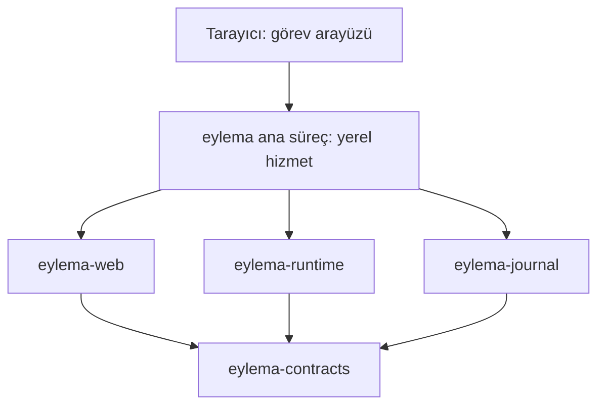

# Proje yapısı ve ilk çalışan uygulama

Sürüm **0.2.0**, 11 Ekim 2026. [İngilizce kaynak](https://github.com/eylema-dev/eylema-docs-en/blob/main/docs/project-structure.md).

**Kabul edilen yön:** önce görev çekirdeği ve web arayüzüyle görev oluşturma, çalıştırma, durdurma, kaydetme ve yeniden açma akışını kanıtlamak. Bakımcı bu akışı 11 Ekim 2026 tarihinde seçti. **Uygulama önerisi:** aşağıdaki bileşen adları, bağımlılık yapısı ve iş yükü EYL-003 öncesindeki mimari inceleme içindir. Bu belge Rust çalışma alanı veya uygulama sağlamaz.

## Tek platform, küçük bir ilk uygulama

Eylema'nın uzun vadeli kapsamı AI destekli geliştirme ve yerel eylemci işletimi için bir Rust web platformudur. İlk uygulama güvenilir görev yürütme ve kurtarma temelini kurar. Sonraki 3B, GPU, model ve öğrenme aşamaları bu temeli genişletir; ilk tarayıcı gösterimi için ön koşul değildir.

Önerilen iş yükü, görünür ilerlemesi ve kayıtlı sonucu olan sınırlı sayıda deterministik adımdır. Adımlar yalnız uygulamanın kendi görev durumunu değiştirir. Kullanıcı görev oluşturur, başlatır, olaylarını inceler, kalan işi durdurur, yerel hizmeti yeniden başlatır ve aynı kayıtlı görevi tekrar açar. Böylece model erişimi veya GPU gerektirmeden durum, yetki, iptal ve kalıcılık sözleşmeleri somut olarak denenir.

## Dil ve depo yerleşimi

İngilizce kanoniktir; Türkçe onun eşzamanlı karşılığıdır. Kod, tanımlayıcılar, şablonlar ve teknik görev kayıtları İngilizcedir. [Organizasyon depo haritası](https://github.com/eylema-dev/devguide/blob/main/docs/tr/repository-map.md) depo sınırlarını tanımlar. Bu depo güncel Türkçe ürün belgelerini tutar; Rust çekirdeği ve şemalar `eylema` içinde birlikte kalır. Katkı politikası `devguide` içindedir. Bölünme belge sahipliğini değiştirir; aşağıdaki önerilen çalışma zamanı mimarisini değiştirmez.

## Önerilen Rust bileşenleri

Tek Cargo çalışma alanı ve tek yerel ana süreçle başlayın. Bunlar modül sorumluluklarıdır; bağımsız yayımlanan hizmetler oluşturma şartı değildir. Bir crate ancak sınırı çalıştırılabilir testlere ve gerçek bir tüketiciye sahip olduğunda eklenir.

| Planlanan bileşen | Sorumluluğu | İzin verilen doğrudan proje bağımlılıkları |
|---|---|---|
| `crates/eylema-contracts` | Sürümlü görev, öneri, yürütme, komut, olay, yetki, bütçe ve hata tipleri | Yok |
| `crates/eylema-runtime` | Deterministik geçişler, kabul kontrolleri, sınırlı adım yürütme ve etkili iptal | `eylema-contracts` |
| `crates/eylema-journal` | Sürümlü yerel kayıtlar, ekleme/yeniden oynatma ve açık kurtarma hataları | `eylema-contracts` |
| `crates/eylema-web` | Asgari HTML arayüzü, sınırlı istek çözümleme ve yanıt/olay sunumu | `eylema-contracts` |
| `apps/eylema` | Ana giriş noktası, yerel yapılandırma ve runtime, journal, web bileşimi | Yukarıdaki dört bileşen |
| `eylema-examples/task-console` | Yeniden üretilebilir görev tanımı, test verileri ve tarayıcı rehberi | Uygulamanın açık sözleşmeleri |

Görev konsolu örneği, `eylema-examples` içinde çekirdek revizyonuna sabitlenmiş dış tüketicidir; çekirdek çalışma alanının başka bir crate'i değildir. Çekirdek birim/kurtarma örnekleri doğruladıkları uygulamayla birlikte kalır.

Bağımlılıklar sözleşmelere doğru yönelir. Runtime tarayıcı, GitHub veya model sağlayıcı entegrasyonlarını içe aktarmaz. Ana süreç kalıcılığı ve yürütmeyi birlikte yönetir; web bileşeni yetki kontrollerini atlayamaz veya günlüğe doğrudan yazamaz. İletim biçimleri aynı sürümlü anlamların adaptörleridir. Gelecekteki tarayıcı/Wasm yürütmesi ayrı destek profili alır; macOS'a bağlı tarayıcı arayüzü runtime'ın Wasm'da çalıştığını kanıtlamaz.

Mevcut politika kapsamında kendi Rust üretim kodumuz ve sıfır harici üretim Cargo paketi kullanılır. Rust, tarayıcı, işletim sistemi ve gerekli host bağları açık bağımlılıklar olarak kalır. CI Python'ı uygulama runtime'ının dışındadır. Native Mac hedefi için Rust 1.99.0 ve aarch64-apple-darwin; açıkça taşınabilir kütüphaneler için wasm32-unknown-unknown seçilmiştir. G04 gerçek araç/SDK/tarayıcı envanterini doğrular; G07 Rust kaynağı kabulünden önce gerçek derleme/test kapılarını etkinleştirir. Günlük biçimi, istek kodlaması ve host bağları ayrı incelenmiş uygulama gerektirir.

## Mac host ve taşınabilir kütüphane sınırı

İlk deneysel cihaz 24 GB birleşik bellekli tek Apple M4 Pro MacBook Pro’dur; macOS 27.0.1 gözlenmiştir, araç envanteri ve gerçek yürütüm G04’te doğrulanacaktır. Native hizmet/CLI, dayanıklı journal ve sonraki CPU/Metal model işçileri host’a aittir. Tarayıcı aynı cihazda Wasm/WebGPU/WGSL ile render yapar. Wasm’a yalnız incelenmiş taşınabilir kütüphaneler derlenir; dosya sistemi/sunucu host’u native kalır. Hedef seçimi veya çapraz derleme kabul edilmiş yürütüm değildir.

Sonraki Metal/model/orkestratör modülleri yalnız test edilmiş sınır ve gerçek tüketiciyle eklenir. Tarayıcı kapanması native işçiyi durdurmaz; yeniden açılış kayıtlı durum/olaylara bağlanır. Journal varsayılanı macOS Application Support/Eylema’dır; onay dayanıklı yazıdan sonra verilir, normal kayıtlara ham özel eğitim içeriği veya kimlik bilgisi girmez. Linux ve ikinci cihaz kabulü sonraki kapsamdır.

## İlk tarayıcı gösteriminin kabul koşulları

[API sözleşmesine](api-reference.md) göre görev kimliği ve yürütme kimliği ayrıdır. Görev çalıştırılmadan önce var olabilir. Tekrar deneme veya iptal, etkilediği yürütmeyi belirtmelidir. Kaydetme, kabul edilen değişikliklerin kalıcılık özelliğidir; ekran tasarımıyla icat edilen yeni bir API işlemi değildir.

| ID | Senaryo | Gereken kanıt | Yol haritası |
|---|---|---|---|
| F1 | Geçerli görev oluştur ve incele | Kalıcı görev kimliği, kapsam, bütçe ve revizyon; geçersiz girdi reddi | M1–M2 / EYL-004, EYL-006 |
| F2 | Yetkili deterministik görevi çalıştır | Kayıtlı yürütme, sıralı ilerleme ve sonuç; reddedilen eylemin yetkisiz etkisi yok | M1–M2 / EYL-004 |
| F3 | İş sürerken yürütmeyi durdur | İsteğin alınması ile etkili durma ayrı; kalan adımlar durur; tamamlanan etkiler görünür; geç durdurma tamamlanmış sonucu korur | M1–M2 / EYL-004, EYL-006 |
| F4 | Yeniden başlat ve kayıtlı durumu aç | Aynı görev/yürütme kimlikleri, revizyonlar, sonuçlar ve olaylar; sürmekte olan işin kurtarma politikası denenir | M2 / EYL-005, EYL-006 |
| F5 | İsteği tekrarla veya eski revizyon gönder | Aynı tekrar özgün referansı döndürür; farklı içerik ve eski revizyon açıkça reddedilir | M1–M2 / EYL-004, EYL-005 |
| F6 | Yazmayı kes veya uyumsuz kayıtla karşılaş | Tanımlı kurtarma ya da açık hata; uydurma tamamlanma ve sessiz veri kaybı yok | M2 / EYL-005 |
| F7 | Limit aş veya erişilemeyen yetenekle karşılaş | Sınırlı girdi/kuyruk/iş, açık hatalar ve süre dolduktan sonra doğru sonuç bildirimi | M1–M2 / EYL-003, EYL-004, EYL-006 |

Depolama sözleşmesi yazının ne zaman kalıcı olduğunu ve günlük hatasının alındı yanıtını nasıl etkilediğini belirtmelidir. Durdurma isteği başarı kanıtı, sürenin dolması da işin durduğunun kanıtı değildir. Yeniden başlatma, sonucu belirsiz dış etkileri sessizce tekrar yürütmemelidir. İlk iş yükünde dış etki yoktur; kayıtlar yine bu ayrımı korumalıdır.

Önce Rust durum makinesi ve kurtarma testlerini M4 Pro Mac üzerinde native çalıştırın, ardından adlandırılmış tarayıcıda bu hizmete bağlı arayüzü gösterin. Wasm derlemesini ve varsa gerçek Wasm yürütmesini ayrı raporlayın. M1/M2; WebGPU, model çıkarımı, eğitim veya otonom geliştirme desteği kanıtlamaz.

## Uygulamadan önce verilecek kararlar

| Karar | Öneri veya bilinen sınır | Gereken sonuç |
|---|---|---|
| İlk ürün sonucu | Yukarıdaki görev çekirdeği ve web akışı | Bakımcı seçti; bu hedefin değişikliklerini açıkça kaydet |
| Çalışma alanı sınırları ve iş yükü | Bileşen tablosu ve sınırlı deterministik adımlar | EYL-003 öncesi öneriyi incele; dizin adları yayımlanmış paket değildir |
| Toolchain ve ilk cihazlar | Tek M4 Pro/24 GB fiziksel Mac ve ayrı bağlı native/tarayıcı iş yükü profilleri | G04’te Rust 1.99.0/hedefleri ve gözlenen macOS/SDK/tarayıcı envanterini doğrula; bu cihazda iş yüklerini ölç; Linux ve ikinci fiziksel cihaz ertelenmiştir |
| Kalıcılık ve kurtarma | Açık kalıcılık anlamlarıyla yerel ekleme/yeniden oynatma günlüğü | EYL-005'te biçim/sürüm, yarım yazı tespiti, tekrar/idempotency saklama süresi ve sürmekte olan işin kurtarılmasını belirle |
| İlk ağ erişimi | Yalnız loopback üzerinden yerel prototip önerisi | EYL-006 öncesi yerel oturum, Host/Origin, CSRF, istek limitleri ve yetki kontrollerini zorunlu tut; uzak kullanım ayrı kimlik/TLS tasarımı ister |
| Kamuya açık dağıtım koşulları | Lisans seçimi bekliyor | EYL-001'i bakımcı kararlaştırır; kaynak görünürlüğü yeniden kullanım koşullarını belirlemez |

Sonraki uygulama işi, bileşen önerisi ve gerekli ortam kararları kabul edildikten sonra EYL-003'tür. EYL-004'ün ihtiyaç duyduğu en küçük çalışma alanını kurun, gerçek Rust CI'ını bağlayın ve aynı değişiklikte yalnız dokümantasyona izin veren kaynak engelini değiştirin. EYL-005 ve EYL-006, kayıtlı görevle ilk tarayıcı akışını tamamlar. Sonraki her yetenek için ayrı kabul gerekir.
